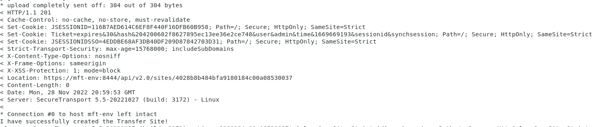
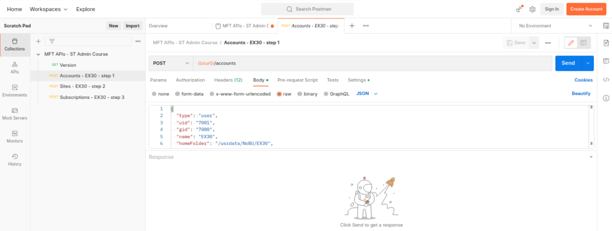

# Axway University
# SecureTransport APIs

| ST Update | January 2026 |
| ---- | ---- |
| Exercise Update | November 2026 |

---

## Exercise 30 – Basic Application Flow

### About This Exercise

This lab is an introduction to creating an account using APIs. We will present two ways of accomplishing our goals. The first is via the Linux command line, which is useful for any command line scripting purposes. The second method is using the Postman API client, which is far more typical usage for developers. Postman has been installed on your Linux desktop and pre-populated with many of our scenarios.

---

### Task 1: Create Account – Command Line

1. Open a terminal session on your lab server

2. Navigate to the `STSOURCE/EX30` folder

   ```text
   cd ~/STSOURCE/EX30
   ls
   ```

3. You will see several files. One is the JSON that you will be issuing to create your account. Examine the JSON:

   ```text
   more stCreateAccount.json
   ```

4. Either copy and paste the JSON and use the Swagger UI to perform the POST to your system via `https://mft-env:8444/api/v2.0/docs/index.html` and the accounts API

   **OR**

   issue the curl command on the Linux command line if you are comfortable using Linux shell scripts:

   ```text
   ./stCreateAccount.sh
   ```

5. Whichever method you use, verify that the EX30 account was successfully created on your system and that you can log in to it using the login name and password you provided.

> **HINT:** Use the Web Client at port 8443.

> **BONUS:** Try creating the account using the other method that you did not use.

---

### Task 2: Create the Transfer Site – Command Line

So far, all we have done is create the standard user account. No file flow can take place yet. For an actual file flow, we need, as a minimum, a transfer site and a subscription. Let's assume the requirement is to transmit any file uploaded to account EX30 in folder `toInstructor` to your instructor's server, which represents a remote partner.

1. Create the Transfer Site which will connect to your instructor's server. For this, you will use the two files `stCreateSite.sh` and `stCreateTransferSite.json`

2. Check the JSON so that you can see what is being created, and either run the shell script or issue the POST from the Swagger UI

   

> **NOTE:** If using the shell script, note that we added the `-v` switch to the curl command so that you can see more details of what is happening. On successful site creation, note the **Location** header output. This time, the Location header provides the ID of the Transfer Site that was created.

---

### Task 3: Create the Subscription – Command Line

1. In a similar fashion to the prior task, create the subscription using the files `stCreateBasicSubscription.json` and `stCreateSubscription.sh`

2. Check that your basic application name is correct in the provided JSON. You may need to ensure it matches your name.

3. On success, you should see a Location header returned with the subscription ID.

---

### Task 4: Validate your API Creation by Performing a File Transfer

1. Upload any file to the EX30 account into directory `/toInstructor`

2. Check the File Tracking log to ensure the file was transmitted successfully to your instructor's server

---

### Alternate Method using Postman

### Task 5: Create Account – Postman

1. Open the Postman application on your desktop (it is found under *Accessories*)

2. Expand the *MFT APIs – ST Admin Course* collection

 

3. Select **Send** in the *POST Accounts – EX30 – step 1* API

   

4. Note the successful creation via an HTTP response status of `201`

5. Similarly, add the transfer site and the subscription

> **NOTE:** In all cases, examine the returned Location header and use the Swagger UI and the Admin UI to look at what was actually created within SecureTransport.

---