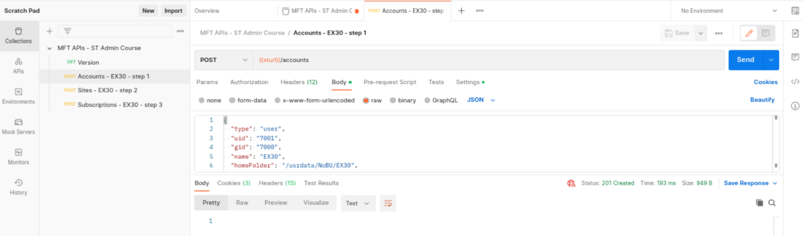
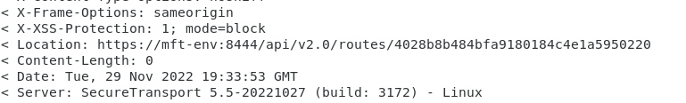

# Axway University
# SecureTransport APIs

| ST Update | January 2026 |
| ---- | ---- |
| Exercise Update | April 2026 |

---

## Exercise 31 – Advanced Routing Flow

### About This Exercise

In this exercise, you will construct an advanced routing flow. The use case is that an internal application uploads to the EX31 account into folder `/toInstructor`. An advanced route takes the file and transmits it to your instructor's server, which represents an external partner. Incoming files will have the filename modified by the addition of a datetime tag.

---

### Task 1: Locate JSON and Scripts

   ```text
   cd ~/STSOURCE/EX31
   ls
   ```

---

### Task 2: Create the Account

Either run the script `stCreateAccount.sh` or use the Swagger UI with a copy of the associated account JSON `stCreateAccount.json`

   ```text
   ./stCreateAccount.sh
   ```

---

### Task 3: Create the Transfer Site to Connect to your Remote Partner

1. Edit the file `stCreateSite.json`

2. Change the `uploadFolder` to be `/fromYourservername`{: .green} (see Exercise 1 Task 2 to determine your server's name). Use upper case for the first letter of your server name.

3. Using the script or the Swagger UI, create the associated Transfer Site

4. Make a note of the Transfer Site ID. This is part of the Location header that is returned on a successful creation.

---

### Task 4: Create the Advanced Routing Subscription

1. Run the script:

   ```text
   ./stCreateSubscription.sh
   ```

   Or use the Swagger UI to POST the subscription JSON as in `stCreateAdvancedSubscription.json`

2. Make a note of your Subscription ID, again from the Location header

---

### Task 5: Create an Empty Route Package Template

1. Run the script:

   ```text
   ./stCreateEmptyTemplateRoute.sh
   ```

   This will create a Route Package Template called *NoSimpleRoutes*, which you will use in your package routes.

2. Make a note of the Route Package Template ID

   

---

### Task 6: Create the Simple Routes and Steps

> **NOTE:** Next, you are going to create the Simple Routes and steps that will be used in the package route. This is contrary to how it would be built using the GUI, which would build the package/composite route first.

1. Examine the JSON for the simple route:

   ```text
   cat stCreateSimpleRoute.json
   ```

2. Pay particular attention to the `transferSiteExpression` and note the addition of the required delimiter **#!#CVD#!#**

3. Note that the date expression requires an escape for the quotes that it uses

4. Create the object and make a note of the ID

> **NOTE:** At this point, the object cannot be seen in the GUI!

---

### Task 7: Create the Package/Composite Route

This glues all the components together and completes the flow setup. Note that the route type is `COMPOSITE`. This is exactly the same as the *PACKAGE* route type in the GUI.

1. Before doing anything, edit the `stCreatePackageRoute.json` file and substitute the IDs for **your** subscription, route package template, and simple route

   

2. Your simple route ID will be placed in the `executeRoute` key

3. Confirm that you received an HTTP status code of `201` when you created the Package route

---

### Task 8: Validate your Flow by a Real File Transfer

1. Connect to the Web Client and log in to your EX31 account (`https://mft-env:8443`)

2. Upload a test file and then confirm all is well using the Admin UI

   

---