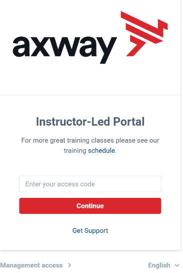
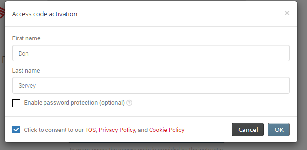
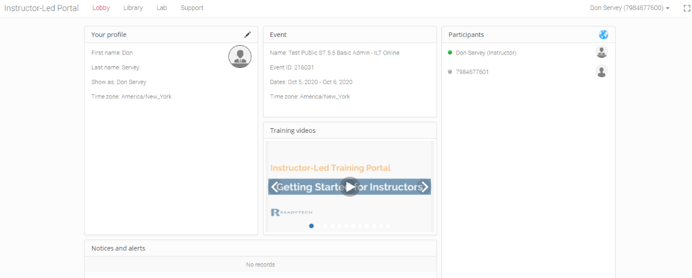
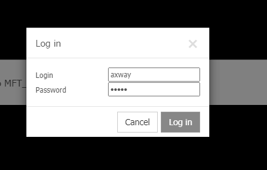
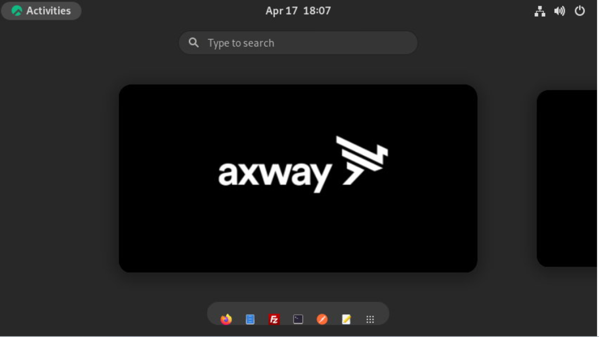
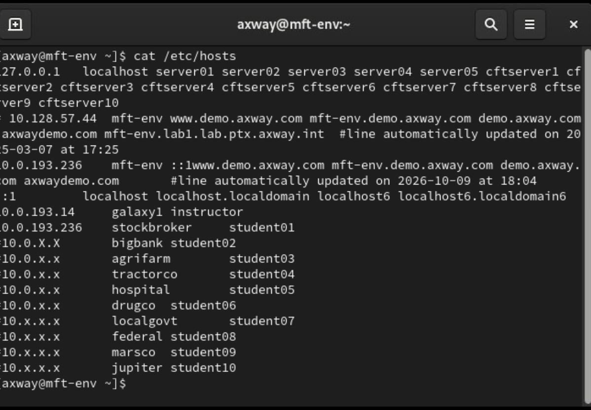

# Axway University
# SecureTransport File Flows

| ST Update | May 2026 |
| ---- | ---- |
| Exercise Update | October 2026 |

---

## Exercise 1 – Introduction to the Environment

### About This Exercise

In this exercise, you will be introduced to the SecureTransport environment which will be used during this class and you will learn how to use the system.

---


### Task 1: Access the Training Environment

In this task, you will connect to the Axway/ReadyTech training environment and log into your training server.

1. Open a browser on your desktop

2. Navigate to `https://axway.instructorled.training`

   

3. Enter the access code provided by your instructor and click *Continue*

4. When logging in for the first time, you will be presented with an access code activation dialog box. Enter your first and last name, check the consent box, and click **OK**.

   

5. Once logged in, you will see the following:

   

6. Click on *Lab* at the top of the screen

7. Verify that *ReadyTech View (HTML)* is selected in the *Remote desktop* section, then click **Connect to the lab**

8. Enter `axway` in the *Login* and *Password* fields of the *Log in* dialog box

   

9. At this point you should have access to your lab server desktop

   

> **NOTE:** Click on **Activities** at the top left corner at any time to bring this UI to the front. If there are open applications (such as Firefox, Filezilla and so on), you will see them here as well.

---

### Task 2: Know your own Parameters

Each course attendee will have their own unique parameters for use within the labs. The exercises use `green`{: .green} highlighting wherever you need to substitute your own values.

You can find your server name by opening a Terminal on your server and typing 

   ```text
   cat /etc/hosts
   ```



Find the second line with the IP shown on the line that also contains mft-env ('mft-env' is the hostname of the server image we are using) and take a note of your server name and IP. For example in the screenshot above, the server name is `stockbroker`{: .green}  and the student number is `student01`{: .green} . 

Alternatively you can ask your instructor for your server name and student number and you may also have received them earlier.


---

