# Axway University
# SecureTransport File Flows

| ST Update | May 2026 |
| ---- | ---- |
| Exercise Update | October 2026 |

---

## Exercise 4 – Server Initiated Transfers

### About This Exercise

In the previous exercises, we had a human logging into ST to upload a file. Now let's look at a different way for ST to receive files: retrieving them from an external partner's server based on a schedule. Once we receive the file, we will then put it in a folder on our file system where another application can find and consume it. 

### High Level Solution

In order to achieve our goal, we need to create the following objects:
1. An account which will be used to start the process and then deliver the file to its final destination. In this exercise we will use the account we already created: *John*. As the process will be fully automated, we do not need John to be able to login so we will modify the account to achieve that.
2. A Transfer Site to connect to the partner's server. As we already know how to connect to the instructor server, we will use the site *Instructor* that we used in the previous exercise.
3. A Transfer Site which will represent the recipient (in this case the folder we want to drop the file into)
4. A subscription which will connect the two parts of the scenario. 

If you prefer, you can also create a new account and site but the screenshots and instructions assume that you are using the already created objects.

---

### Task 1: Disable Logins for the Existing Account John

1. Edit the *John* account

2. Uncheck the *Allow this account to login to SecureTransport Server* checkbox

   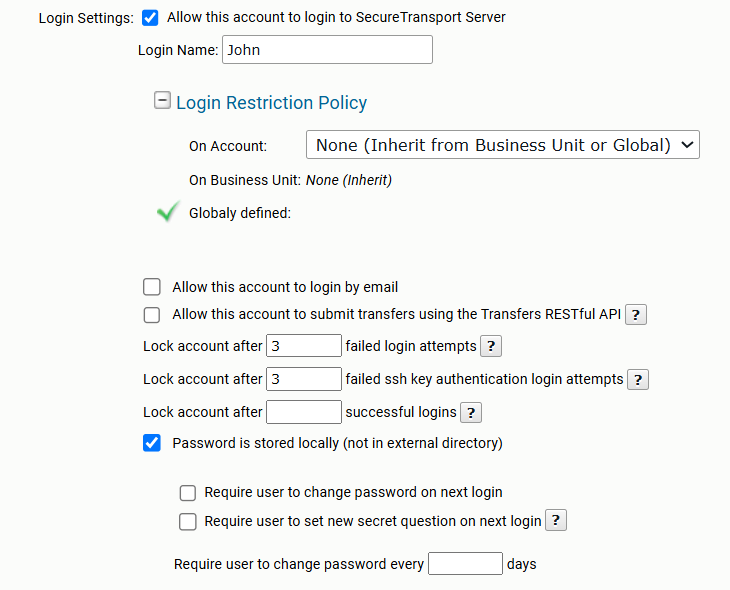

3. Click *Save* at the bottom of the screen.

If you try to login with *John* in the user interface (as we did in the previous exercises), you will see an error. This is expected. If you want to rerun the previous exercises, you will need to enable the logins again and add a password for *John*.

---

### Task 2: Modify the Instructor Transfer Site

1. Edit *John*'s *Instructor* Transfer Site

2. In the *Download Folder* field, add `/toStockbroker`{: .green} (substitute your own server name as we did for the upload folder)

3. Add a file Download pattern of `*.ex4`

   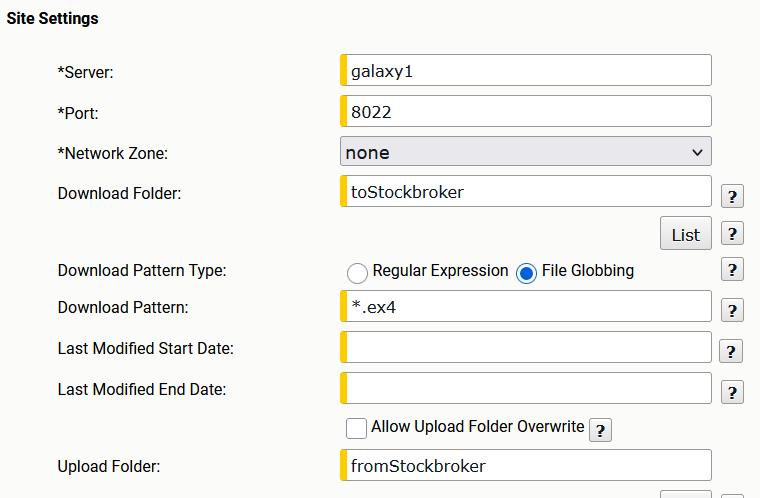

4. Click *Save* (you can use either the button at the top of the screen or the one at the bottom).

---

### Task 3: Create a Folder Monitor Transfer Site

This transfer site will be used to push files retrieved from your instructor's server to a folder on your own local system.

1. In the *John* account, select the *Transfer Sites* tab and then *Add New*

2. Change the transfer Protocol from AS2 to *Folder Monitor*

3. Call the site `FM_TMP`

4. In the mandatory *Download Folder* enter `/nofiles`. This folder will not be used in this exercise.

5. The download pattern should be *nothing* or a string that never matches a filename (we do not wish to use the folder monitor for pulling any files and this will ensure that even if someone configures it by mistake and the download folder exists, no files are being pulled).

   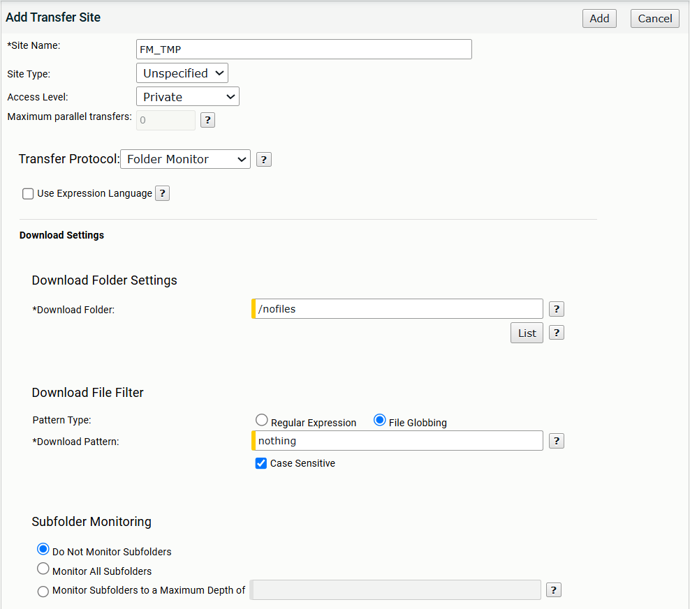

6. Enter `/tmp` in the upload directory. Leave all other values to their default settings.

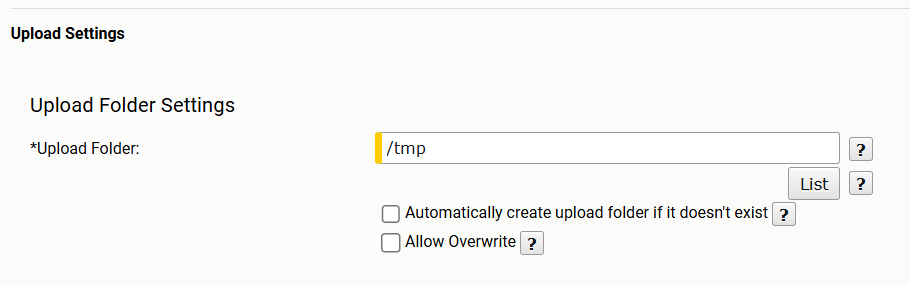

7. Click *Add* to save your Folder Monitor

---

### Task 4: Create a New Subscription

1. In the *John* account, select the *Subscription* tab

2. Subscribe to the same application we used in the previous exercise: *BasicApp*

3. Change the Subscription folder to be `/pulledFromInstructor`

4. Select the *Automatically retrieve files from* box and click on the *Instructor* transfer site

   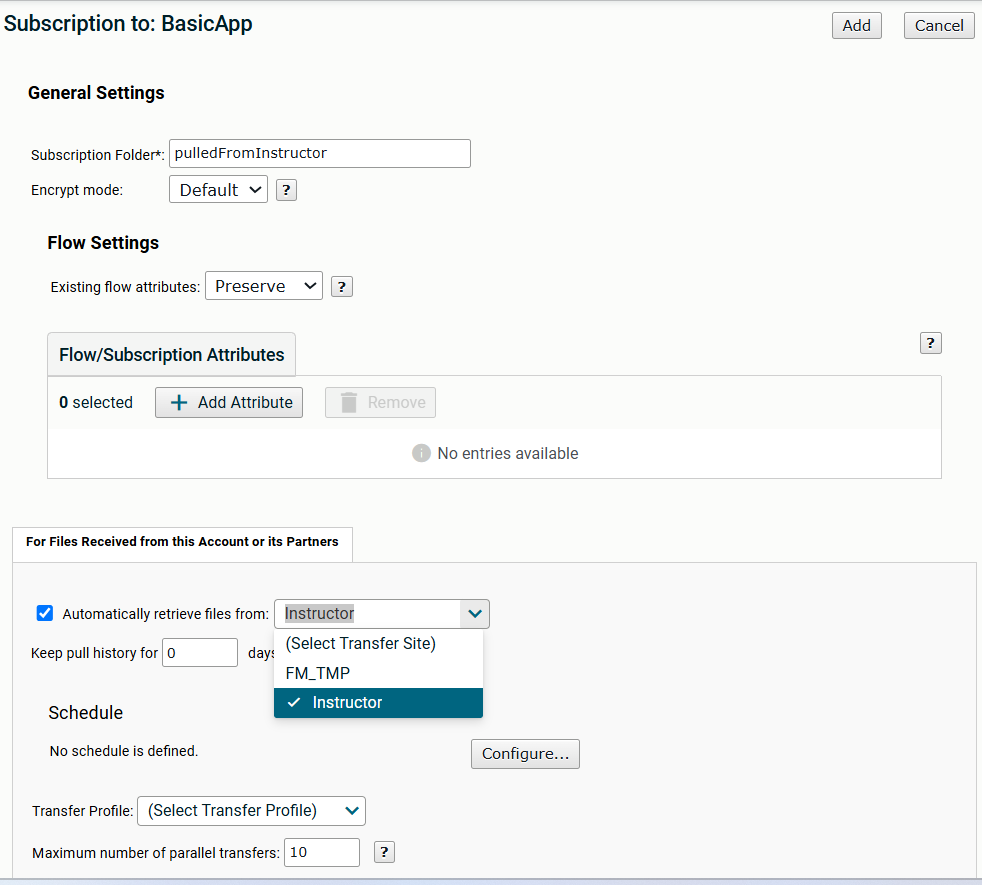

5. Click on *Configure...* under the *Schedule* area

6. On the scheduler pop-up, check *Schedule events on a recurring basis*

7. Select *Hourly*, change the "hours" drop down to "minutes" and enter `30 minutes` for the schedule. Select a start time or leave it on "Start now". The clock on the right corner of the scheduler page shows you the time in the server timezone (which is used by all schedulers on the server).

   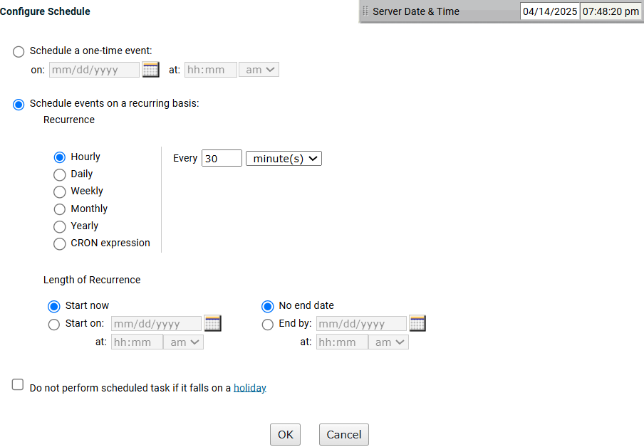

8. Save your scheduler using *OK*

9. Enter `5` days in the *Keep Pull history* box to stop the server from pulling the same file every 30 minutes.

   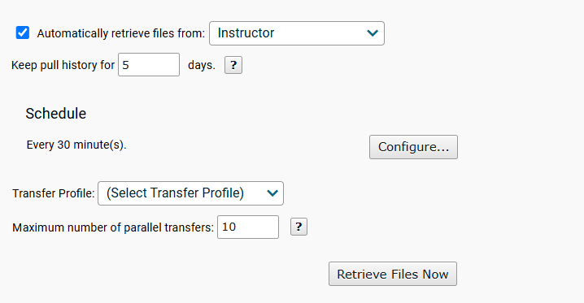

10. Select *FM_TMP* as the destination for your files and select *On Success -> Delete* at the bottom of the screen in the *Post Transmission Settings* section

    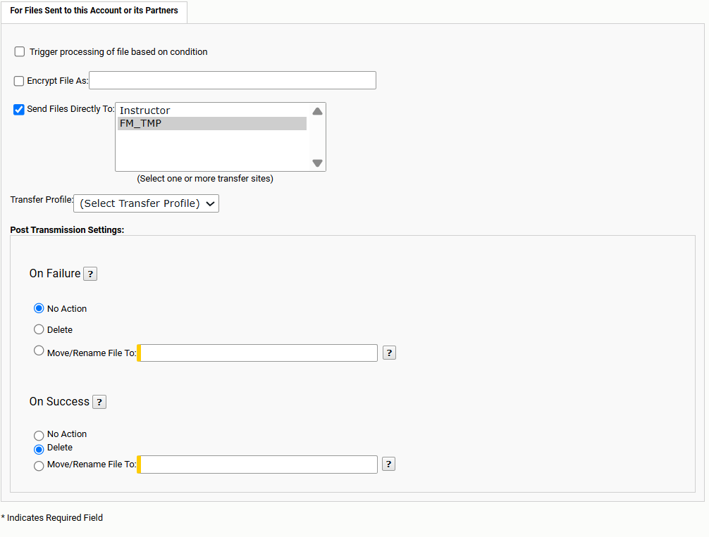

11. Save your subscription using *Add*. You should now have two subscriptions in your account.

    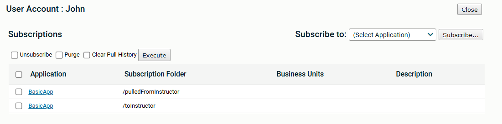

---

### Task 5: Manually Initiate the Server Pull

> **NOTE:** If you set the start time to 'Start now' in the previous task, skip this task and move to the next one. 

1. On John's *Subscription* tab, click the `/pulledFromInstructor` BasicApp Subscription to edit it

2. Click the *Retrieve Files Now* button to manually trigger the pull

   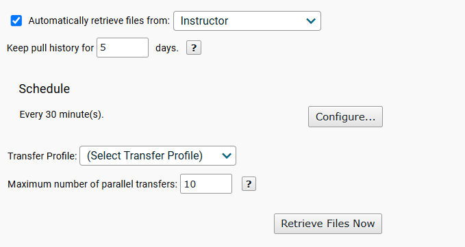

---

### Task 6: Validate the Pull is working

1. Check the File Tracking table

   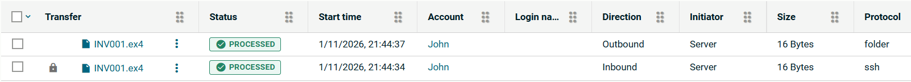

If you see any issues or there are no file transfers, check the Server Log and use the transfer site's *List* and *Connectivity* options to troubleshoot.

---

### Task 7: Initiate the Pull again

1. Select the *Retrieve files now* button on the Subscription again and observe the tracking table

   Why are no files being pulled this time? Check the Server Log and note the message telling you why no files were downloaded.

   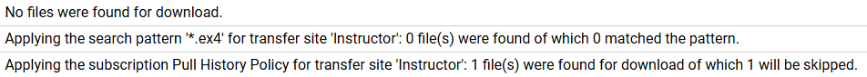

2. On the *Subscriptions* tab of the John account, select the subscription by checking the checkbox in front of it, check the *Clear Pull History* option, and then click *Execute*

   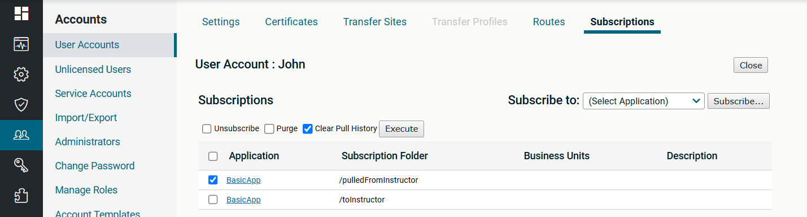

3. Confirm that you can pull the same file again now.

---
