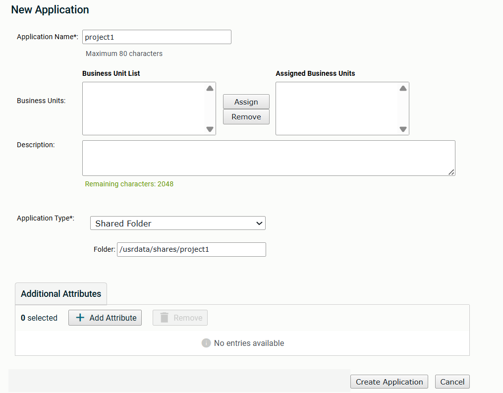
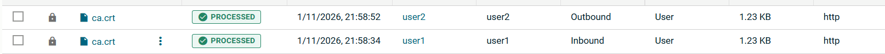

# Axway University
# SecureTransport File Flows

| ST Update | May 2026 |
| ---- | ---- |
| Exercise Update | October 2026 |

---

## Exercise 5 – Shared Folder Application

### About This Exercise

In this exercise, we want to allow two accounts to share content without being able to see each other's entire directory structure and without the need for each user to have their own copy of the files. 

### High Level Solution

To implement the solution, we will create the following objects:

1. A Shared Folder Application to indicate which folder we want to share between the different accounts
2. Two new user accounts. In the last exercise we disabled John's ability to login. You can reenable it and use John as one of the two users but the instructions below are using two new users. 

---

### Task 1: Create the Shared Folder Application

| Field | Value |
| --- | --- |
| Application Name | project1 |
| Application Type | Shared Folder |
| Folder | `/usrdata/shares/project1` |

1. Navigate to **Application → Application** in the administrative UI

2. Click *Add New*

3. Enter the information from the table above. 

   

4. Click *Create Application*

---

### Task 2: Create User Accounts and Subscribe Them to the application

**Account 1**

| Field | Value |
| --- | --- |
| Account Name | user1 |
| UID | 7001 |
| GID | 7000 |
| Change Home To | `/usrdata/NoBU/user1` |
| Allow login | Checked |
| Login Name | user1 |
| Password is stored locally | Checked |
| Password | axway |

**Account 2**

| Field | Value |
| --- | --- |
| Account Name | user2 |
| UID | 7001 |
| GID | 7000 |
| Change Home To | `/usrdata/NoBU/user2` |
| Allow login | Checked |
| Login Name | user2 |
| Password is stored locally | Checked |
| Password | axway |

1. Navigate to **Accounts → User Accounts**

2. For each account, click *New Account* and enter the appropriate information above

3. Click *Save*

4. Click the *Subscriptions* tab in each account.

5. Select *project1* from the *Subscribe to* drop-down field

6. Click *Subscribe…*

7. Enter `project1-share` in the *Subscription Folder* field

8. Click *Add*

> **NOTE:** Instead of creating the second account manually, you can duplicate it from the first (make sure you enable the second account after that, as *Duplicate* creates accounts in disabled mode). Do not duplicate the John account because the process will recreate all the additional objects we added in the previous exercises.

---

### Task 3: Share a File

1. Connect to the end user web interface (`https://mft-env:8443`)

2. Log in as *user1*

3. Navigate to the *project1-share* folder

4. Click *Upload*

5. Select a file and click *Open*

6. Log out

7. Log in as *user2*

8. Navigate to the *project1-share* folder

9. Verify user2 sees the file user1 uploaded

10. Click on the file name in the *Name* column to download

11. Verify the file was downloaded as an Admin. Your tracking table should look something like this:

    

---
