# Axway University
# SecureTransport File Flows


| ST Update | May 2026 |
| ---- | ---- |
| Exercise Update | October 2026 |

---

## Exercise 6 – File Flow using Advanced Routing

### About This Exercise

In this exercise, you will simulate a real-world use case. Your internal application called *Manufacturing* will transmit files to SecureTransport, which will then be sent to a remote partner (your instructor's server). In addition we want to make this setup reusable so that other internal applications can send files to your partner as well with mininal configuration.

### High Level Solution

In order to achieve this, we will need to create the following objects in SecureTransport
1. An Account called *Manufacturing* which will represent the internal application. 
2. An Account called *Instructor* which will represent the partner we are sending the files to. This account will not login into ST for this scenario but it will hold all the information we need for ST to connect to their server. 
3. A Transfer site inside of the *Instructor* account to allow us to connect to their server. 
4. A Route Template which implements the business logic (send the file to the partner after renaming it based on the partner's request).
5. An Advanced Routing application
6. A Composite Route Package in the *Manufacturing* account which uses the template route we just created
7. A subscription in the *Manufacturing* account to determine which files are sent to Instructor. 

We are not going to reuse any of the objects we created in earlier exercises. 

---

### Task 1: Create a New Account called Manufacturing

| Field | Value |
| --- | --- |
| Account Name | Manufacturing |
| UID | 7001 |
| GID | 7000 |
| Home Directory | `/usrdata/NoBU/Manufacturing` |
| Password | axway |

---

### Task 2: Create a New Account called Instructor

| Field | Value |
| --- | --- |
| Account Name | Instructor |
| UID | 7001 |
| GID | 7000 |
| Home Directory | `/usrdata/NoBU/Instructor` |
| Password | axway |

You can also leave this user without an ability to login onto ST. You can create this user by following the usual "New Account" process or you can duplicate the Manifacturing account. Don't forget to enable the account if you create it via the duplication process.

---

### Task 3: Create a Transfer Site in the Instructor Account

Create a shareable transfer site with connectivity to the Instructor server that is accessible from ANY account or route in your SecureTransport server. This is achieved by setting the Access Level on the Transfer site to Public (the default value is Private).

| Field | Value |
| --- | --- |
| Transfer Protocol | SSH |
| Site Name | TS_SFTP_Instructor |
| Access Level | Public |
| Server | galaxy1 |
| Port | 8022 |
| Username | axway |
| Password | axway |
| Upload Folder | `fromStockbroker`{: .green} (substitute your own server name) |


   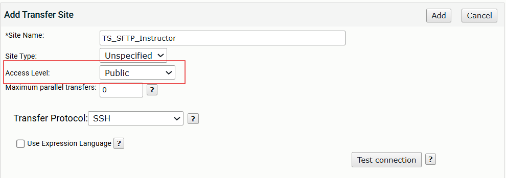

---

### Task 4: Create a Route Template

1. Navigate to **Routes → Route Templates** and click *+ Route Template*

   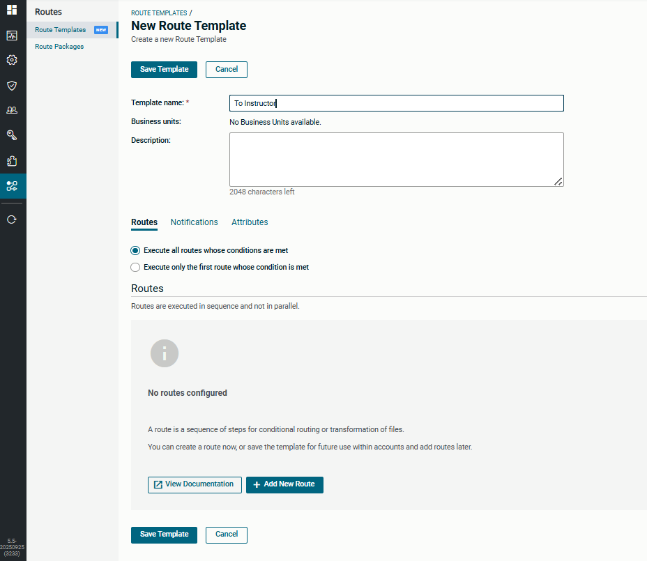

2. Create a new Route Template called `To Instructor`

3. Click *+ Add New Route* to add a new Simple route

4. Name: `SR_toInstructor` (leave all other fields at their default values)

   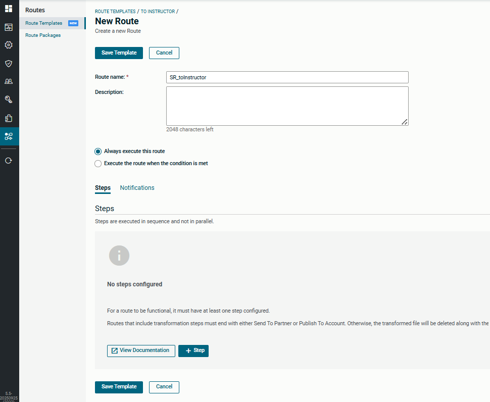

5. Click *+ Step* to add a Rename step

6. Select *Rename* from the list of steps

7. Leave all values at default except for the *Output File Names*. Enter the following expression:

   ```text
   ${basename(transfer.target)}_${date("yyyy-MMM-dd_HH-mm")}
   ```

   This expression removes the extension from the filename and replaces it with an underscore followed by the current date and time. For example, `st.txt` becomes `st_2025-Oct-21_13-41`.

   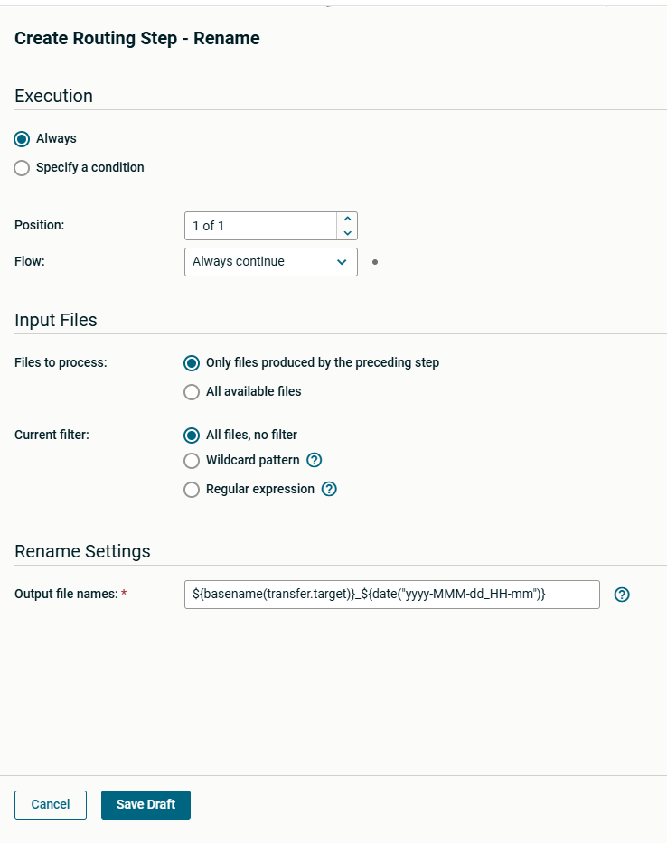

8. Press *Save Draft*

**Add a Send To Partner step:**

9. Click *+ Step* (it is in the header line of the table that shows your rename step) and select *Send To Partner*


10. Specify an account: `Instructor`. If you start typing the name, ST will autocomplete for you based on the existing accounts in the server.

11. Select the *TS_SFTP_Instructor* transfer site in *Account's Transfer Sites* by clicking on the field to open the drop down box.

12. Select *Stop on Failure* in the *Flow* dropdown box

    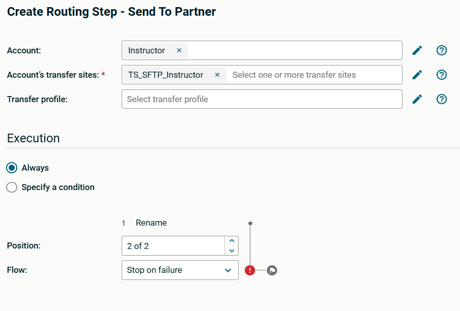

13. Click *Save Draft* to save the step

14. Click *Save Template*, then *Close*

---

### Task 5: Create an Advanced Routing Application

1. Navigate to Application -> Application and click *Add New*

2. Provide a name – `AdvRouting` or anything you prefer

3. Select *Advanced Routing* from the dropdown

   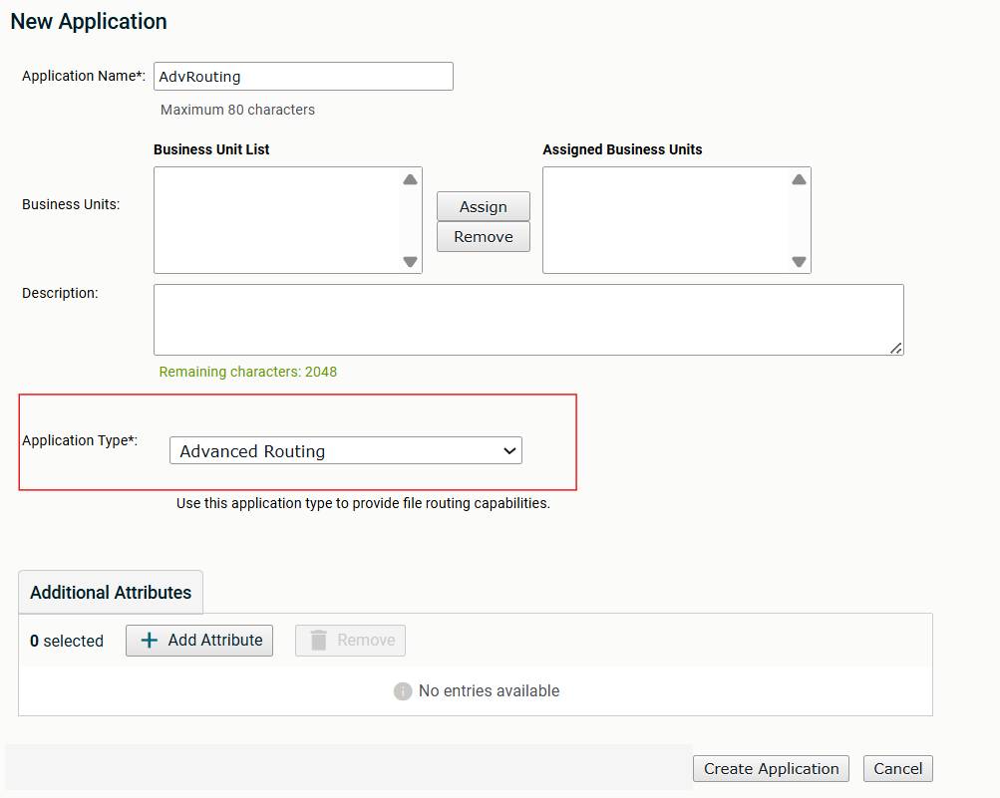

4. Click *Create Application*

> The Advanced Routing application has no scenario-specific settings, so you will often have a single instance used by all subscriptions that use Advanced Routing.

---

### Task 6: Add a Route to the Manufacturing Account

1. Edit the Manufacturing account

2. Select the *Routes* tab

3. Use the dropdown to select the *To Instructor* Route Template and click *+ Assign Route*

   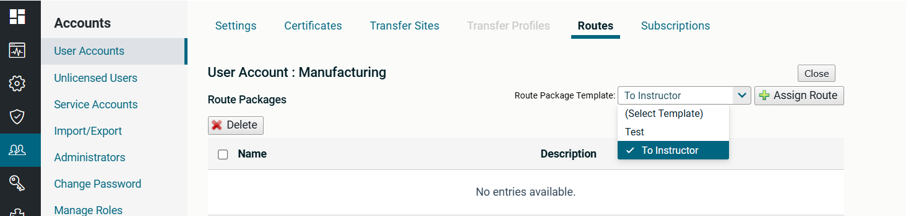

4. Enter `PR To Instructor` as the Route Name. Leave all other fields to their default values. You can see the route we created earlier in the "Template Routes" section. 

5. Click *Save*

6. Click on the *Subscriptions* tab and create a new Advanced Routing Subscription by selecting *AdvRouting* and *Subscribe…*

   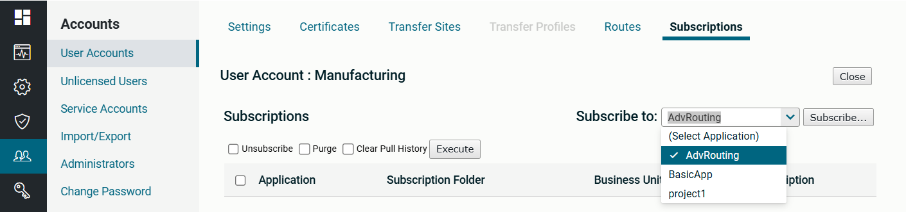

7. Change the Subscription Folder name to `/toInstructor` and select the Route *PR To Instructor* from the Route dropdown

   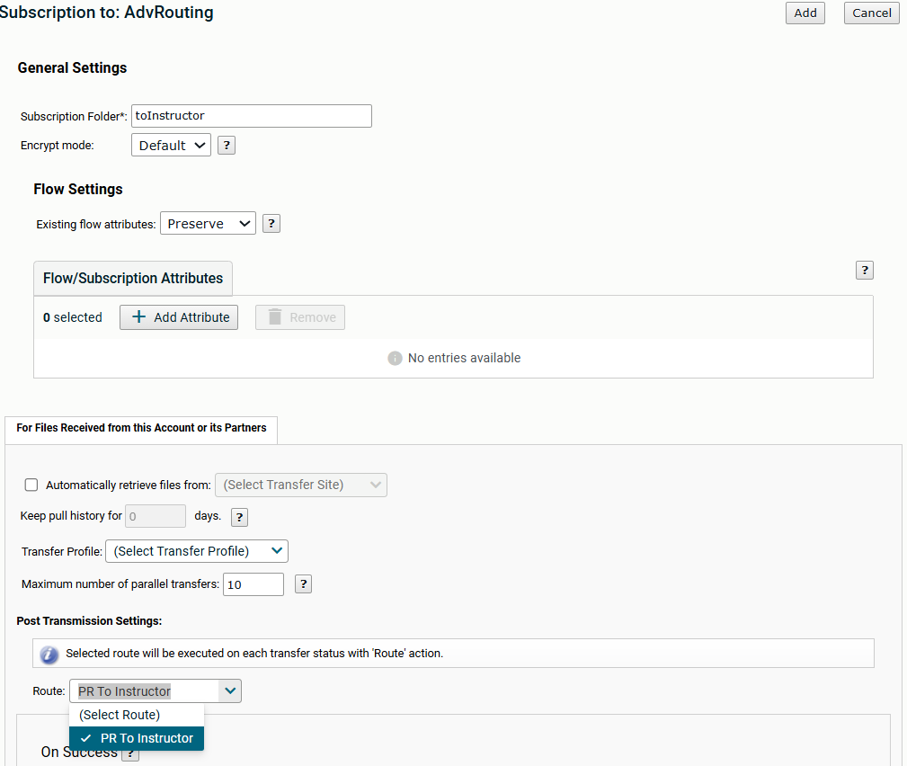

8. Check the *On Success → Delete* option in Post Routing Settings at the bottom of the screen.

   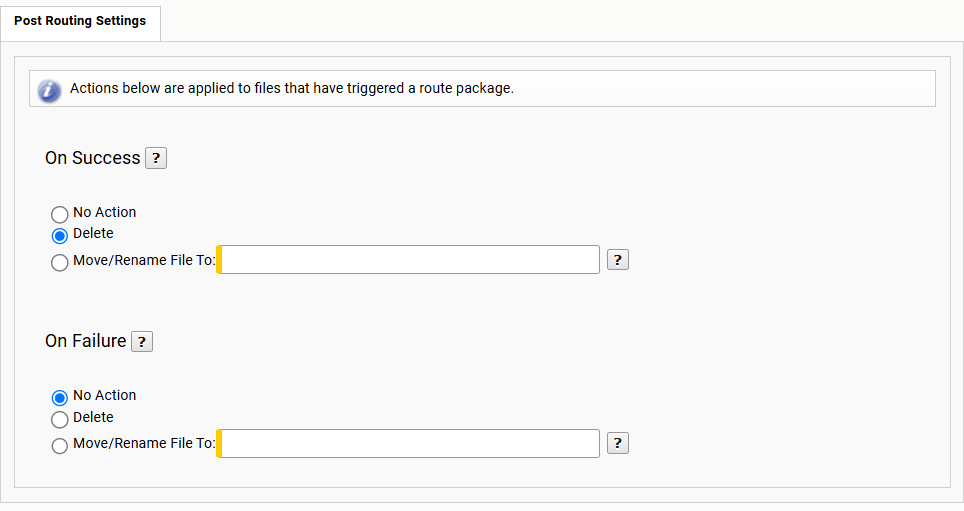

9. Save your subscription by clicking *Add*

Now you are ready to receive files from the Manufacturing application and process them. 

---

### Task 7: Ask your instructor to Send you a file from the Manufacturing Application

1. Let your instructor know you are ready to receive a file, and tell them which server your system is (e.g. `agrifarm`, `stockbroker`). Alternatively you can test your scenario by logging in the Manifacturing account via the User HTTPS interface (running on port 8443 in this lab) and uploading a file into the toInstructor folder. 

2. Validate that the file was successfully sent to your partner (Instructor) and that the filename of the file was transformed on transmission by opening the records in the File Tracking table. 

   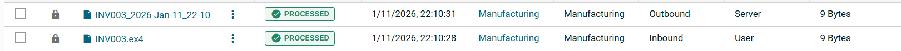

3. You can also verify that all route steps were successful by clicking on the filename of the inbound file in the File Tracking table.
   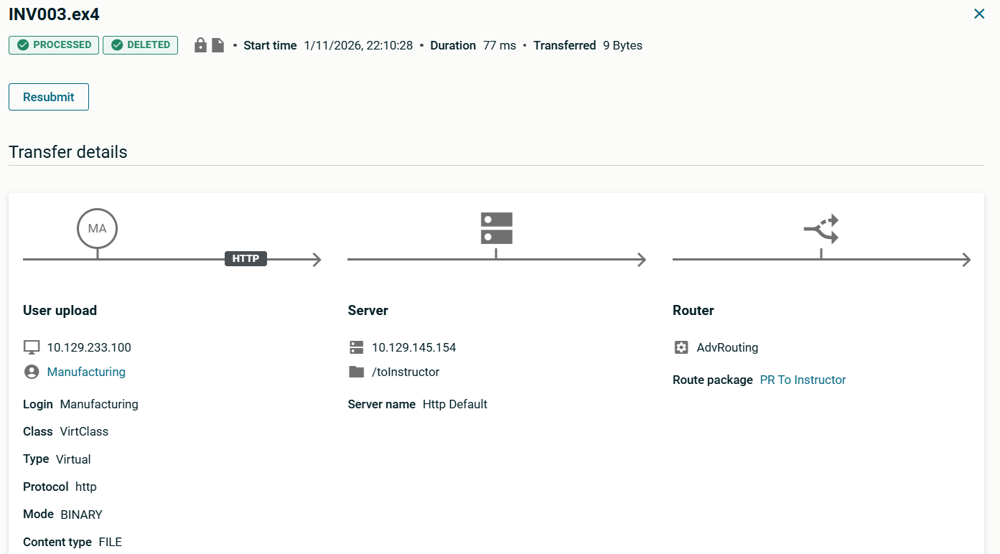
   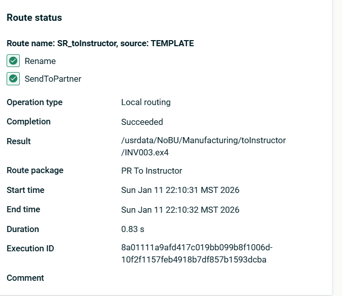


### Task 8: (Optional) Reuse the Existing Setup

The setup was created to allow both the Instructor Transfer site and the Template route to be reused. When a new team, NewProduct, requires to send files to the same partner, what elements do you need to create for them and which elements can you reuse from what we built for Manufacturing? Try to build the NewProduct scenario. 

---
