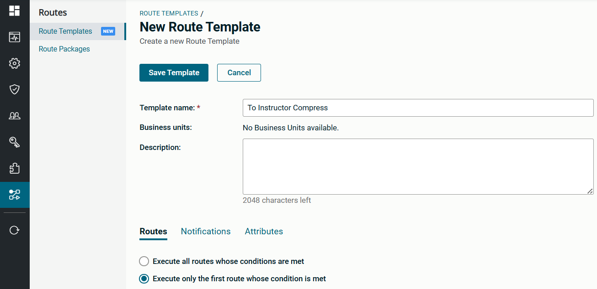
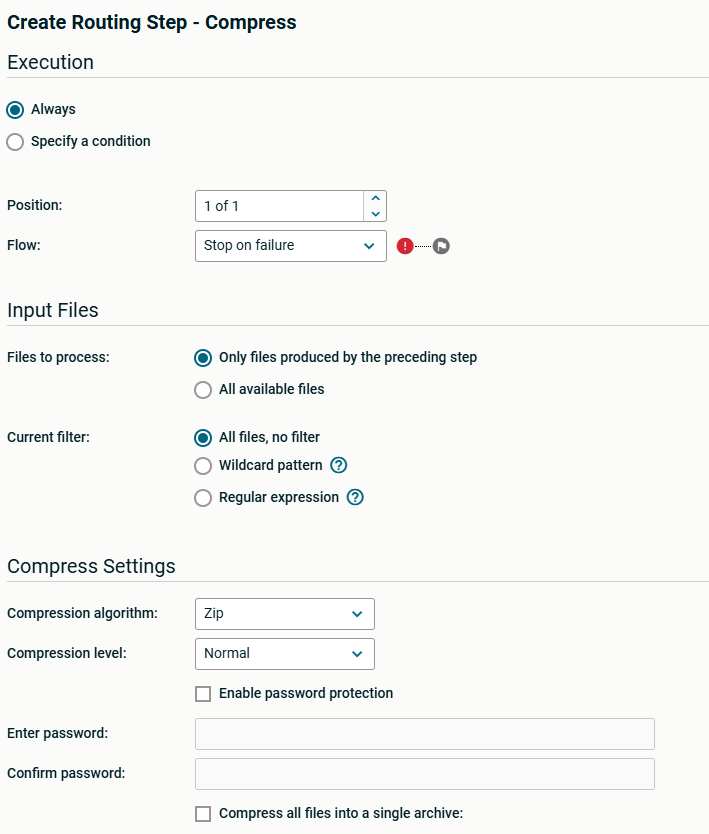
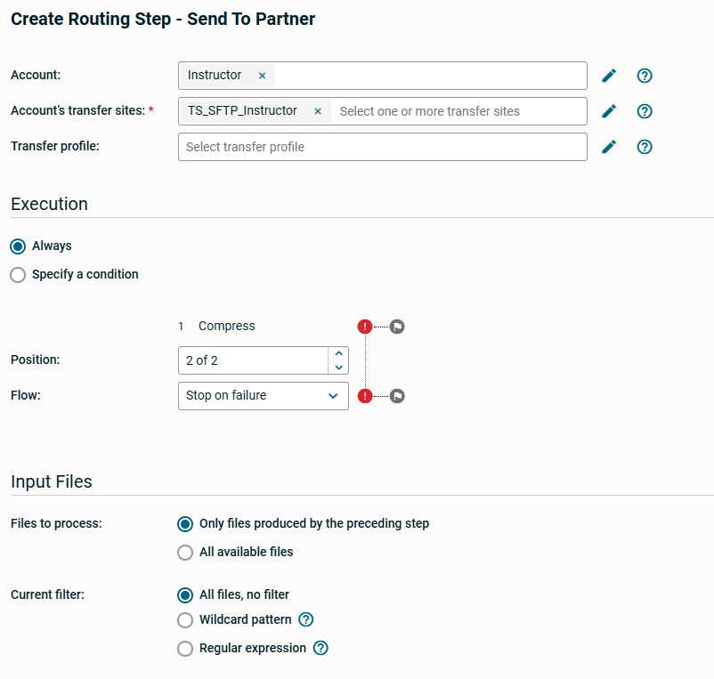
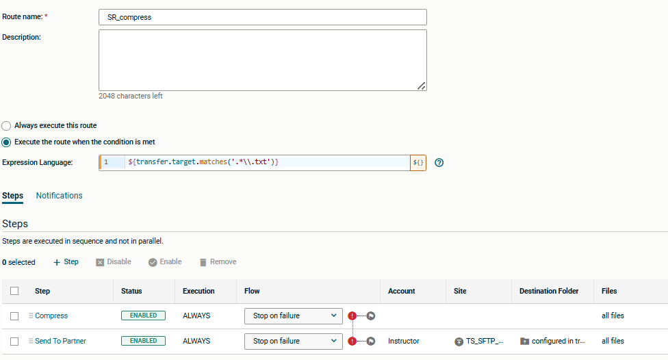
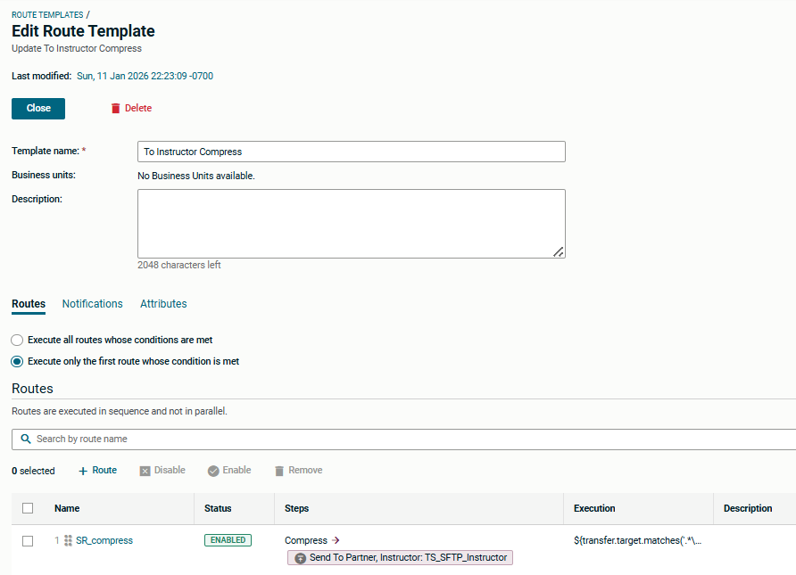
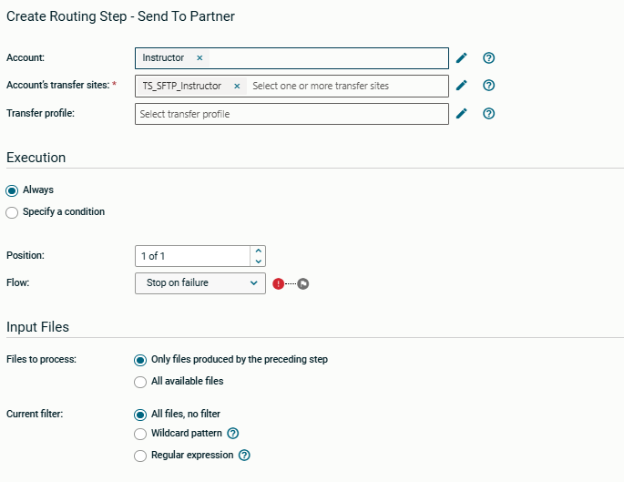
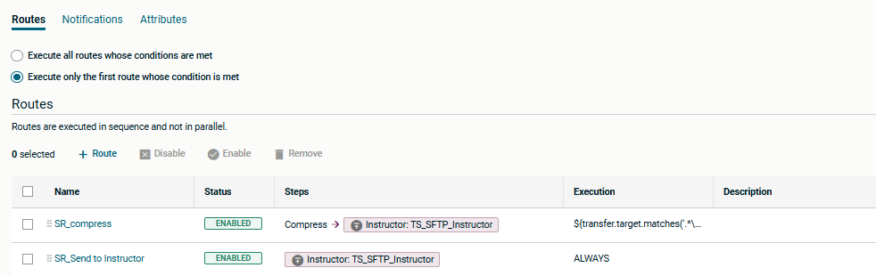
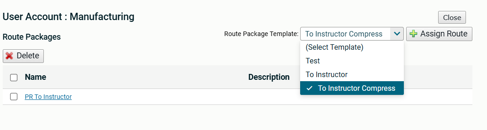
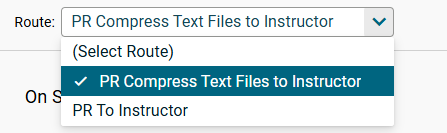
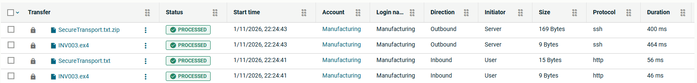

# Axway University
# SecureTransport File Flows


| ST Update | May 2026 |
| ---- | ---- |
| Exercise Update | October 2026 |


---

## Exercise 7 – Conditional Routing 1

### About This Exercise

In all the exercises so far we were routing files based on where they were uploaded. In this exercise, we will implement a more complex scenario: we will process files differently based on their FILENAME. 

The Manufacturing application had requested their files to be handled differently going forward - as they are starting to transmit large text-based design documents, they want these to be compressed while all other files need to be sent as they are received. Their partner had also asked them to stop including the date and time in the filenames. Only the files with a filename extension of `.txt` are considered text files for this request.

### High Level Solution

As this is a request for a change in an existing setup, one of the important decisions that need to be made during the design phase is which objects are to be changed and which ones need to remain as they are. As the previous exercise built the template and the transfer site to be reusable, we are not going to change them here (as the optional task demonstrated, they can be already reused by other applications). 

We will reuse the following objects with no changes:
1. The Manufacturing account itself to receive the files. 
2. The Instructor's Transfer site which is used send the files to the partner.
3. The Advanced Routing application.

We will need to build the following new objects:
1. A new template route which contains the routes handling the optional compression and the sending of the data. 
2. A new composite route package which uses the new template. 

We will modify the following pre-existing objects:
1. The Subscription in the Manufacturing account in the /toInstructor folder to use a different route.


---

### Task 1: Create a New Route Template with a Route for Compressing the TXT files

1. Create a new Route Template called `To Instructor Compress`

   

2. Select *Execute only the first route whose condition is met*

3. Click *+ Add New Route*

4. Call the Route `SR_compress` and select "Execute the route when the condition is met". This will open a new field called *Expression Language* allowing you to enter the condition for the route.

5. In the *Expression Language* field, add the following condition:

   ```text
   ${transfer.target.matches('.*\\.txt')}
   ```

*transfer.target* is a special variable that contains the name of the file entering processing. We will work more with variables and expressions later in the class. For more information, check the inline help in your ST server or the Admin Guide online. 

**Quick regular expression cheat sheet:**

| Symbol | Meaning |
| --- | --- |
| `.` | Matches any symbol once. Use `..` or `.{2}` for exactly two symbols |
| `.*` | Matches any symbol zero or more times |
| `.+` | Matches any symbol one or more times |
| `\\.` | Escaped dot character (usually the start of an extension) |

6. Add the *Compress* step and uncheck *Compress All files into a single archive*. Set the Flow drop down to "Stop on Failure". Leave all the other values unchanged.

   

7. Press *Save Draft*.

8. Add a *Send to Partner* step to transmit the file to your partner (Instructor)'s site. As a reminder, you can start typing the name of the account to bring it up and then select the site from the dropdown that will be populated. Don't forget to tell the step to stop on failure. 

   

9. Press *Save Draft*. Your route should look like this:

   

10. Click *Save Template*. As we are continuing to update this template in the next task, do not close it yet. 

---

### Task 2: Create a Second Route

The new template knows what to do with TXT files but if a non-text file arrives, it has no matching logic. So let's add a new route to handle these files. 

1. If you closed it in the last step of the previous task, open the template you created in the previous task. You should be seeing this screen:

   

2. Click *+ Route*

3. Provide a name for the new route – i.e. `SR_Send to Instructor`

4. Leave *Always execute this route* selected (default). Make sure that you do not accidentally move this route before the previous one in the table or it will catch all files. 

5. Add a *Send to Partner* Step (Click *+Step*) to send the file to your partner (Instructor)'s site. Don't forget to tell the step to stop on failure.

   

6. Press *Save Draft* and *Save Template*. This should leave you in the Template Edit page:

   

7. Click *Close*

---

### Task 3: Add a New Route Package to Your Manufacturing Account

We cannot modify the existing route package because we cannot change which template is used by a route package. As we created a new template, we need to create a new composite route package.

1. Go to the "Routes" tab under the Manufacturing account. 

2. Create a new composite route package by selecting the newly created *To Instructor Compress* template and pressing "+ Assign Route".

   

3. Provide a route name such as `PR Compress Text Files to Instructor`

4. Save the new Route

---

### Task 4: Edit the Subscription in the Your Manufacturing Account to Point to the New Route

1. In the `/toInstructor` subscription of the Manufacturing account, change the route to the one you just created and save the subscription

   

---

### Task 5: Test your scenario

1. You can ask your instructor to send files to the Your Manufacturing account or you can login into the account and upload files in the toInstructor folder. You need both files with an extension `.txt` and ones with a different or no extension to test your setup completely. If you decide to upload your own files, there are some files to use in the different subfolders of `STSOURCE`

2. Check the file flows for each of the received files

   

> Note that the extension `.zip` is automatically added to the filename after the text file is compressed. Any other file is not compressed – it uses the second simple route and is transmitted without change.

The scenario worked as expected but looking at the setup, we added exactly the same step in two different places - in each of the two conditional steps. Can we optimize this setup so that we add the step only once? Let's explore this in the next excercise.

---
