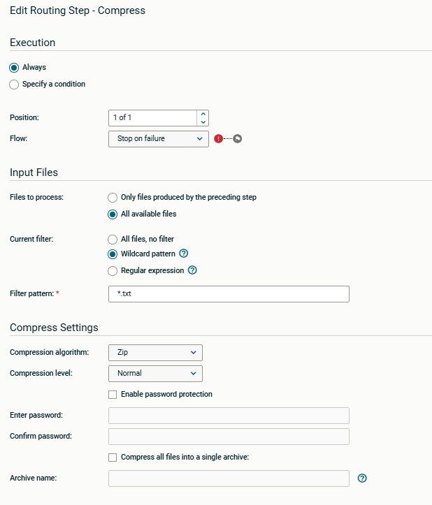
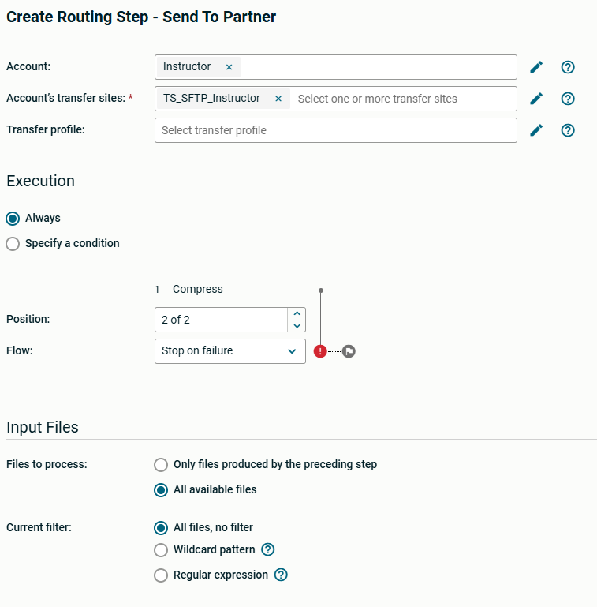
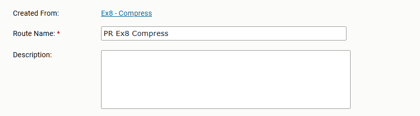
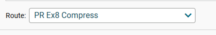
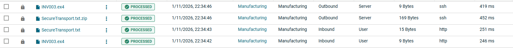

# Axway University
# SecureTransport File Flows

| ST Update | May 2026 |
| ---- | ---- |
| Exercise Update | October 2026 |

---

## Exercise 8 – Conditional Routing 2

### About This Exercise

The Manufacturing application owner does not have any requests for changes but in reviwing your setup, you realized that you did not reuse the Send To Partner step in your prevuous template. Let's optimize the setup so if you need to change the SendToPartner parameters, you do not need to do that in two different places. You also want to make that change invisible for your internal client (the Manufacturing application).

### High Level Solution

Editing route templates can be dangerous - you can see how many composite templates use them but you do not know how many had planned to use them. So we will create a new template for this exercise. Creating a new template will also require a new composite route package and as the client does not want to see a change in their setup, we will reuse their subscription and just point it to the new route package again. 

---

### Task 1: Create a New Route Template

1. Give your Route Template a name such as `Ex8 – Compress`.

2. Add a New Route named `SR_Ex8`. Leave the default setting of "Always execute this route".

3. Add a Compress Step

4. Select *Stop on failure* in the *Flow* checkbox

5. In the *Current Filter* radio boxes field, select *Wildcard Pattern* and specify `*.txt` in the *Filter Pattern* field

   

The compress step will now only execute when a file pattern of `*.txt` is received.

6. Uncheck the *Compress all files into a single archive* checkbox. 

7. Press "Save Draft"

8. Add a *Send to Partner* Step

9. Select *Stop on failure* in the *Flow* checkbox

10. Switch the *Files to process* radio box to *All available files*

   

11. "Save Draft", "Save Template", and "Close"

---

### Task 2: Create a New Route Package in the Manufacturing account

1. Create the route package with the name `PR Ex8 Compress` in the account selecting the "Ex8 – Compress" as the template. Don't forget to press "Save".

   

---

### Task 3: Modify the Subscription to point to the new Route

1. Modify the Manufacturing Account's subscription to point to the new package route

   

---

### Task 4: Transfer files

1. Ask your instructor to send some more files or upload your own files in the Manufacturing account's /toInstructor folder.

   

> Note how the end result is the same as with the previous exercise. If the files not ending in `.txt` were not sent, check that you changed *Files to process* in your Send To Partner step.

---

