# Axway University
# SecureTransport File Flows


| ST Update | May 2026 |
| ---- | ---- |
| Exercise Update | October 2026 |


---

## Exercise 9 – Compression and Subscription Triggering

### About This Exercise

The Human Resources department produces a lot of text files through the day and need to send them to their partner. However, instead of sending the files one by one, they want all the files to be zipped and sent as a single archive. The HR department will initiate the final transmission by uploading a file called `trigger.me`. Any file uploaded by HR that does NOT end with `.txt` should NOT be part of the archive and should be placed into another directory for analysis by the HR team. 

### High Level Solution

So far all the scenarios we implemented has been processing the files one by one. In this scenario we want to handle multiple files at the same time and to delay the processing of any files until the client sends us a file indicating that we need to process all the files. ST can achieve that by setting a trigger condition on the subscription page. 

To implement the solution, we will create the following objects:

1. A new template route which processes the files once the trigger file is received.

2. A  new account for the HR team 

3. A composite route package and a subscription for the HR account

The partner that needs to receive the files is the same one that received the files in previous exercises so we will reuse the Instructor's account transfer site again. 

---

### Task 1: Create a new Route Template 


1. Create a New Route Template called `HR Outbound Processing`

2. Add a Simple Route with name `SR_Compress`

3. Add a compress step filtering for files with a filename pattern of `*.txt`. Make sure that you are stopping on failure. 

4. Leave *Compress all files into a single archive* checkbox checked. This will ensure that all files which match the pattern above are handled together if they reach the step at the same time. 

5. Add `HR.zip` to the "Archive name" field. The files which are added into the zip file will be removed from the sandbox and will not be available for the step after this one.

   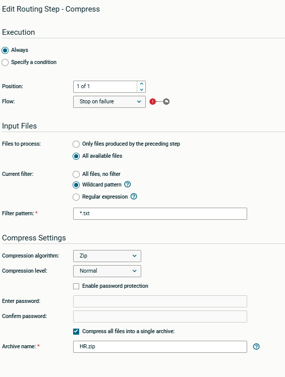

6. Add the *Send to Partner* Step. Make sure that the step processes only the  files coming from the previous step.

   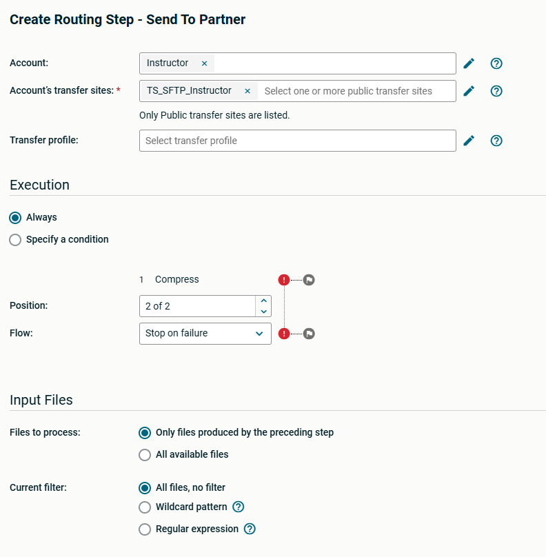

7. Ensure that you check *Delete Files after Step is complete* before pressing "Save Draft". This will remove the zip file from the sandbox folder and will allow us to handle any remaining files without a condition. You can also use a file name filter as you know the name you created but if the name uses variables (i.e. adding a date), the pattern may catch other files and send them to the partner by mistake.

   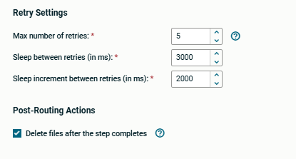

8. Add a *Publish to Account* step. This step will be used to send the files which did get added to the zip file to the folder where the HR team can process them. 

9. Click the pencil next to *Account* to add an expression instead of a name. `${account.name}` gives you the name of the account currently using this route.

10. Add "/UNKNOWN" in the *Folder* field.

11. Select "All available files" in the "Files to Process" radiobox so the step can see the files which the previous step did not use.

12. Make sure that the step stops on failure and in the *Collision Settings* choose "Use a different file name to publish the file".  This will allow for a file to be sent to the folder even if a file with the same name is already there. Your setup should look like this:

   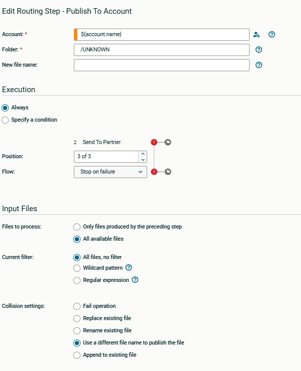

13. Save Draft.

14. The result should look like this:

    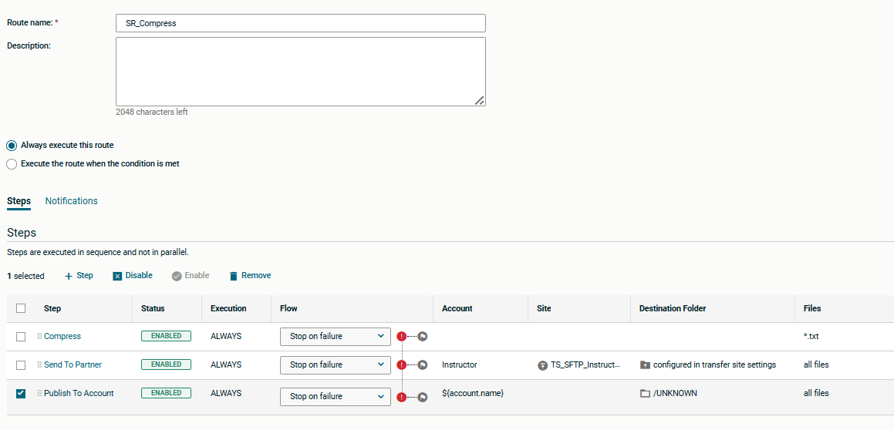

15. Save Template and Close.

---

### Task 2: Create an HR account

1. Create an account with the name `HR` and password `axway`. Fill in the rest of the fields (UID, GID and home folder) similarly to how we did that in the previous exercises. 

   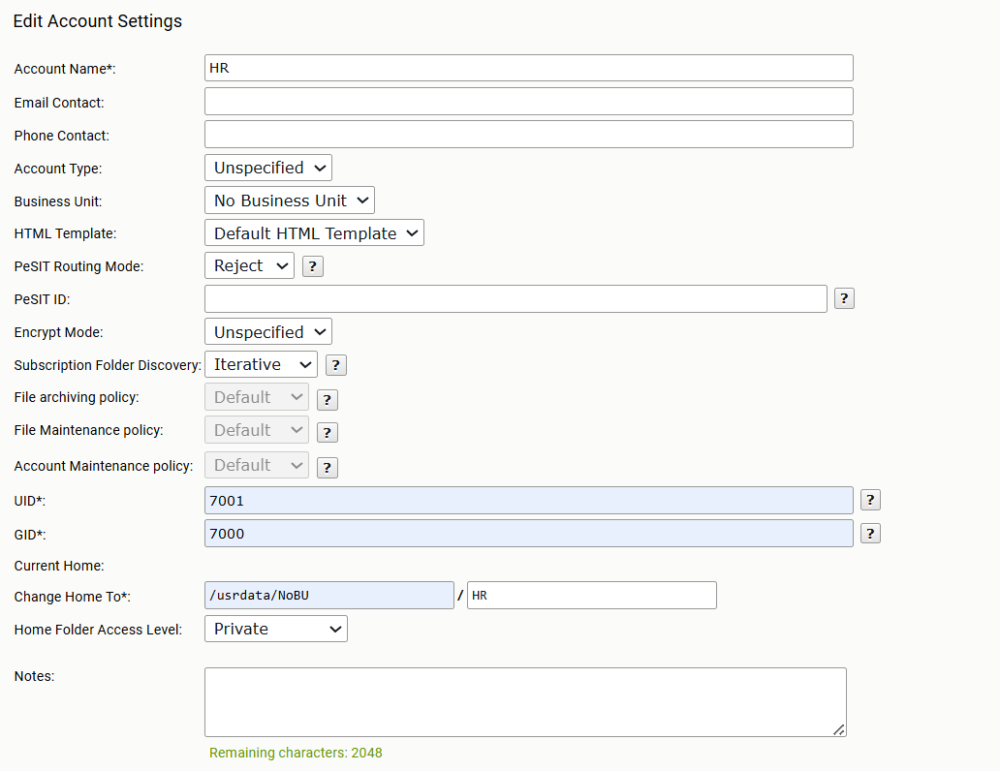

---

### Task 3: Create the Composite Route Package in the HR account

1. Open the HR account, navigate to the Routes tab and create a new Route Package using the `HR Outbound Processing` template route.

   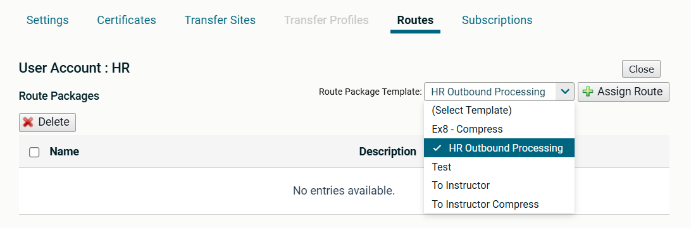

2. Save the Route Package with the name `PR_to_Partner`. Your screen should look like this.

   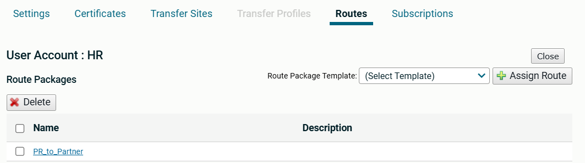

---

### Task 4: Create the Subscription in the HR Account

1. Create the subscription using the *AdvRouting* application with a *Subscription* folder set to `/toPartner` and select the `PR_to_Partner` route to process the files.

   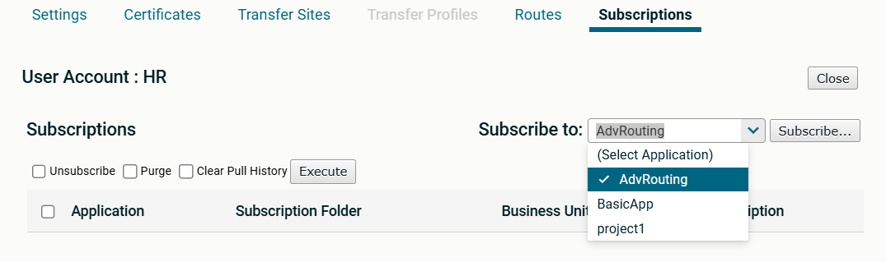


   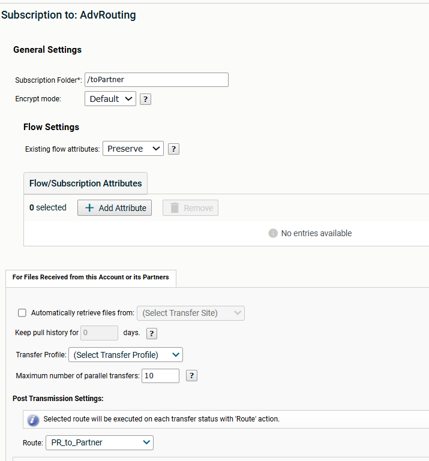

2. Check the *On Success → Delete* option in Post Routing Settings at the bottom of the screen.

   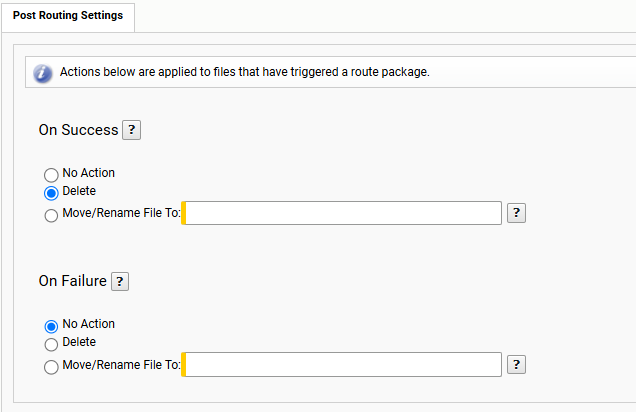

3. If you save the subscription at this point, it will process the files one by one. To implement the trigger-based processing, go to the *Trigger Settings* section and check *Trigger processing of files based on condition*. The section is in the middle of the page, a few options under the place where you selected the route.

   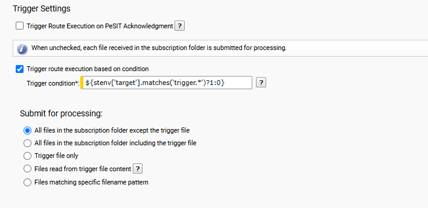

Add a tigger condition and make sure that the all the files except for the trigger file are sent for processing. The trigger condition can be written in two different formats:

   ```text
   ${stenv.target.matches('trigger.*')?1:0}
   ```

   or

   ```text
   ${stenv['target'].matches('trigger.*')?1:0}
   ```
Note that the variables in the subscription page are different from the ones in the route steps and conditions. 
> If you click the *?* button, you will see preset values you can modify to save some typing.

---

### Task 5: Load the Subscription Directory with Files

You could ask your instructor to do this, or log into the HR account via the Web Client and upload your own files followed by a trigger file. Files are provided under `STSOURCE/EX9`. Make sure there are at least a few files with a `.txt` extension.

1. Validate that nothing happens until the trigger file `trigger.me` is uploaded by checking the File Tracking table before you send the trigger.me file or if you check after that by observing that there are not Outbound transfers until the file appears.

   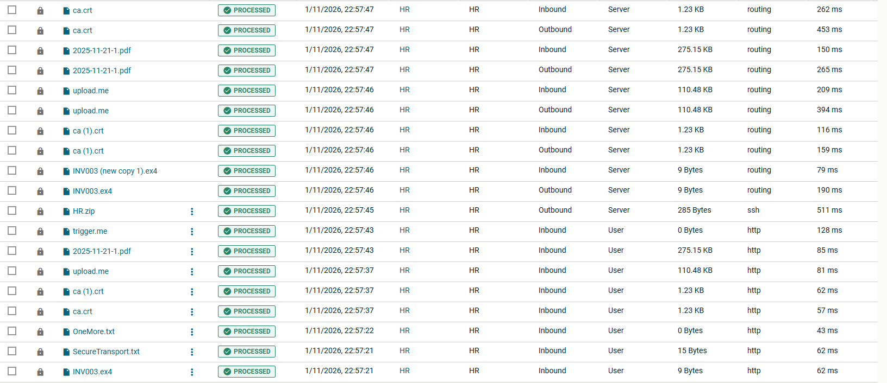

If your HR.zip file is delivered but you do not see the non-txt files being put in the UNKNOWN folder, check your Publish To Account step and verify that it is processing all the files, not only the ones coming from the previous step. 

---

