# Axway University
# SecureTransport File Flows

| ST Update | May 2026 |
| ---- | ---- |
| Exercise Update | October 2026 |

---

## Exercise 10 – Decompression

### About This Exercise

We receive a zip file from our remote partner (`Partner1`) containing two types of files – Invoices (`INVxxxxx.txt`) and Orders (`ORDxxxx.txt`). Invoices (`INVxxxxx.txt` files) go to Purchasing; Orders (`ORDxxxx.txt` files) go to Sales. Any other files inside of the zip file is moved to an UNKNOWN account and should trigger an email to our support organisation so they can investigate and process the file.

### High Level Solution

To implement the solution, we will create the following objects:

1. An empty Route Template. This Route Template can be reused by any future scenario that builds their simple routes inside of the accounts. In this case we will use to setup the sending of the emails when an unknown file is received.
2. An `UNKNOWN` account which will receive the leftover files and send an email to the support team for any file it receives.
3. Accounts for the `Purchasing` and `Sales` teams to receive their files.
4. A Route Template which implements the decompression and the delivery of all files to their final destination.
5. An account for `Partner1` which uses the route template to process the files it receives.  

The order of creation usually does not matter but in this case you want the Route Template for the processing of the files to be created after the 3 receiver accounts (so the UI can assist with autocomplete and thus minimize the chance of typos). The subscription for the `Partner1` should always be created last: it needs prior elements but also as soon as you create it, the partner can upload files in the folder so you should be ready to process them. 

---

### Task 1: Create an 'Empty' Route Template

1. Create a new Route Template called `Empty`, containing no routes (press "Save Template" after adding the name of the template and the "Close" the template).

---

### Task 2: Create an UNKNOWN account

This account will be used to send emails to our support organisation for any files that do not match the expected pattern.

1. Create the UNKNOWN account providing the required parameters (UID, GID, home folder and password) similarly to the accounts we created earlier.

2. Before saving the account, make sure the *Home folder Access Level* is set to **public** so that any other account can send files here. The field is immediately under the *Home Folder* field. 

   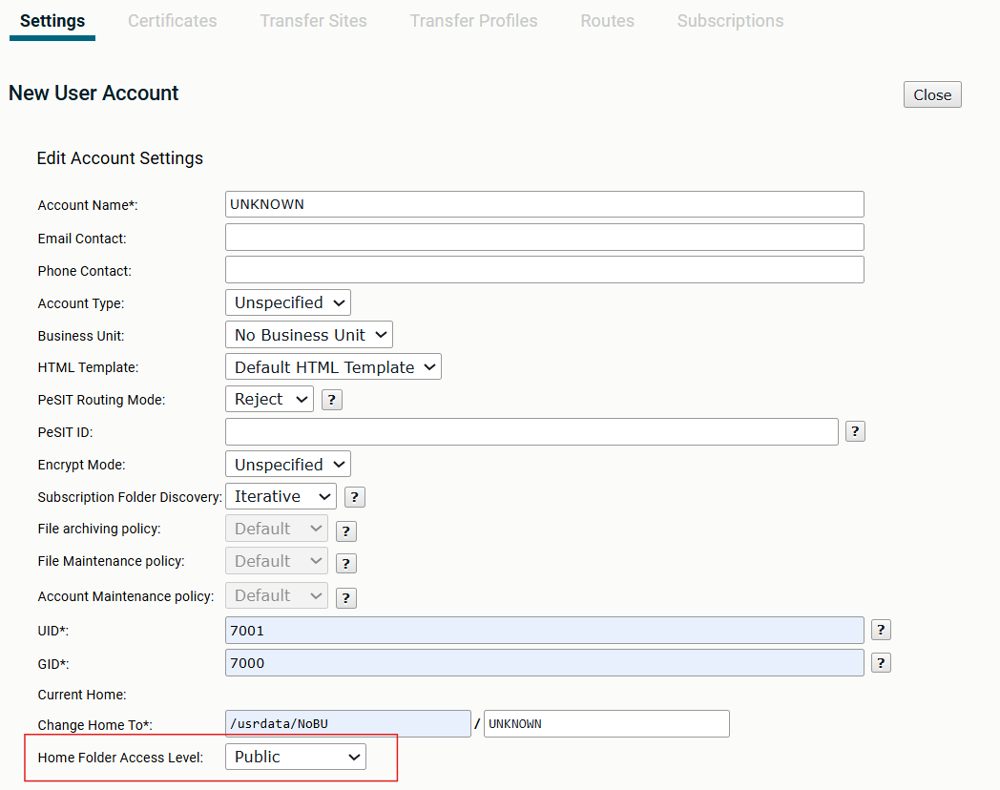

---

### Task 3: Create the UNKNOWN account's Route Package

1. Create a new Route Package that uses the `Empty` Route Template

2. Name the Package Route `PR_Send_Email`

3. Click *Notify Emails on Route Triggering*

4. Enter the email `student01@demo.axway.com`

5. Use the *RoutingTriggeredNotification.xhtml* Notification template

   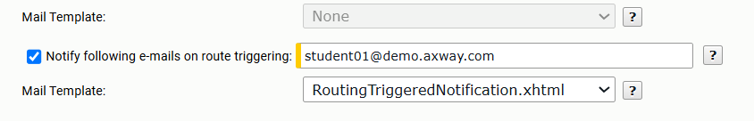

6. Press *Save*. Note that we did not add any routes to this composite route package - it is strictly used to send a notification when a file is received in a subscription using it. 

---

### Task 4: Create the UNKNOWN account's Subscription

Use the Advanced Routing Application.

1. Create a new subscription using the *AdvRouting* application. Change the subscription folder to be the Home folder of the account (indicated with `/`)

2. Select the `PR_Send_Email` Route. 

   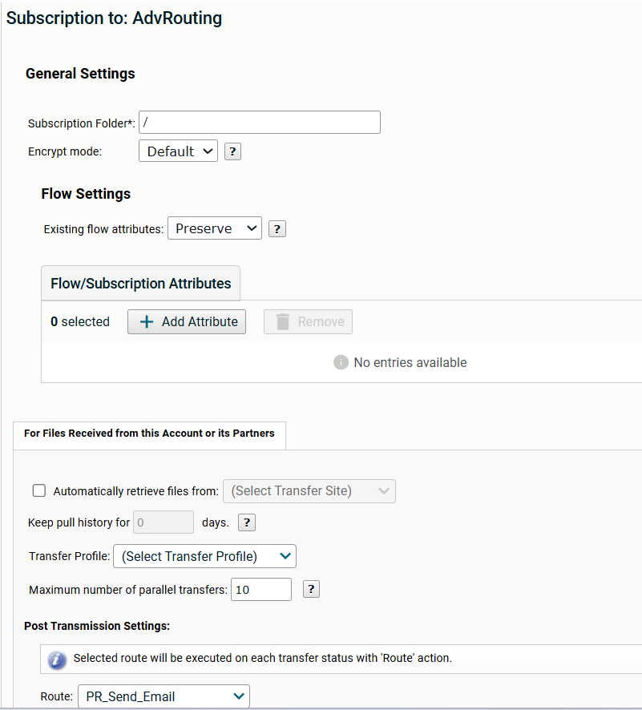

3. Press "Add". Note that unlike any other subscription we built so far, we do not want the file to be deleted on successful routing. The success here is the route triggering and all the route does is sending an email. 

---

### Task 5: Create the Sales Account

1. Create a `Sales` Account (use any password you like and supply the mandatory parameters in the same way we did in all other accounts we had created)

   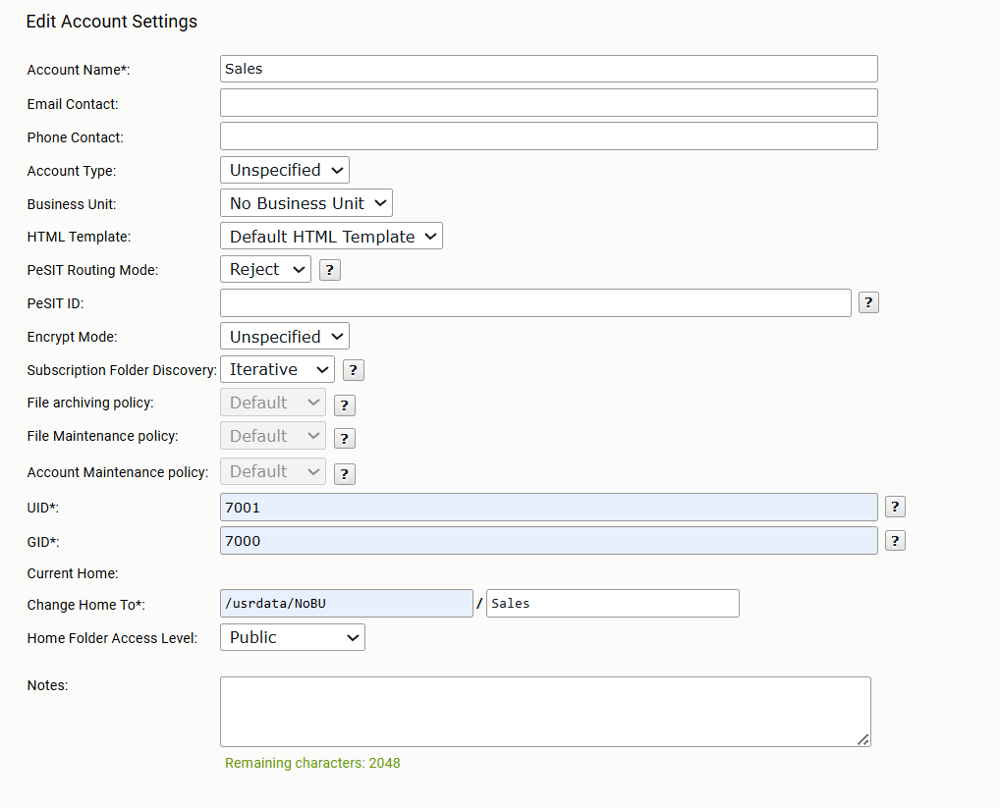

> **Reminder:** Make sure that you set the Home Folder Access Level to Public.

---

### Task 6: Create the Purchasing Account

2. Create a `Purchasing` Account (you can use *Duplicate* account to duplicate the `Sales`instead of creating the new one with "New Account"  – make sure to enable it afterwards)

   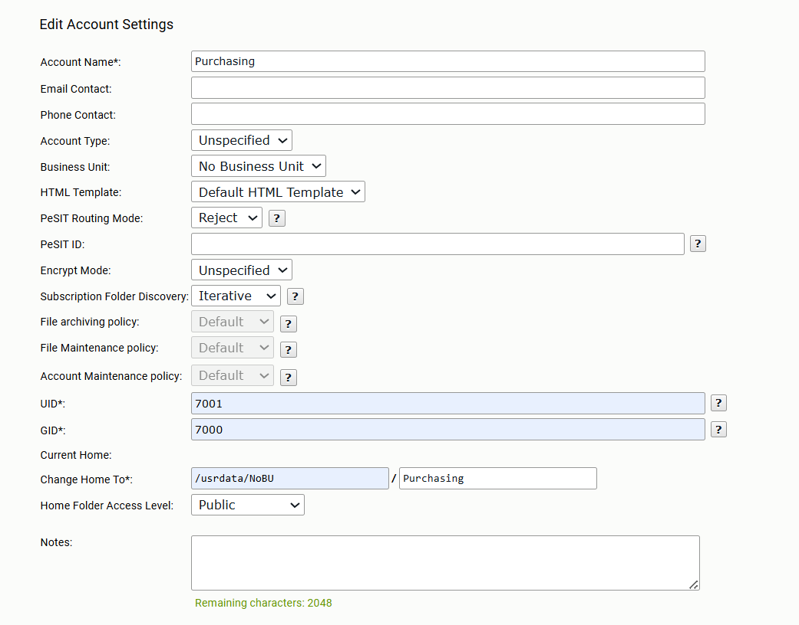
> **Reminder:** Make sure that you set the Home Folder Access Level to Public.

---

### Task 7: Create the Decompress Route Template

1. Create a new Route Template with a name of `Partner1 Decompress`

2. Add a Simple route called `SR_Decompress`

3. Add a Decompress Step

4. Change the *Flow* drop down to *Stop on Failure* and set the *Collision Settings* to "Replace existing file". This setting is needed because ST does not retain the directory structure on decomplress so if the archive contains 2 files with the same name in different directories, you need to determine how the server handles this. Don't forget to press "Save Draft".

   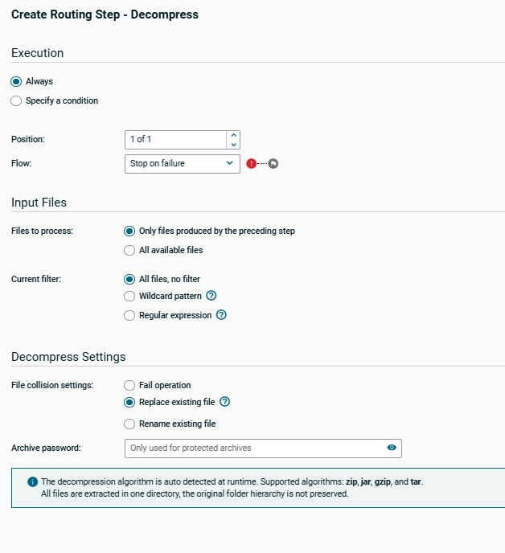

5. Add a *Publish to Account* step to send Invoices to the `Purchasing` account, in the */Invoices* folder and with a wildcard filter for "INV*.txt", processing all available files and not only the ones coming from the previous step. Make sure you delete the file at the end of the step so the next steps do no see the file. Set the collision settings to "Use a different filename..."

   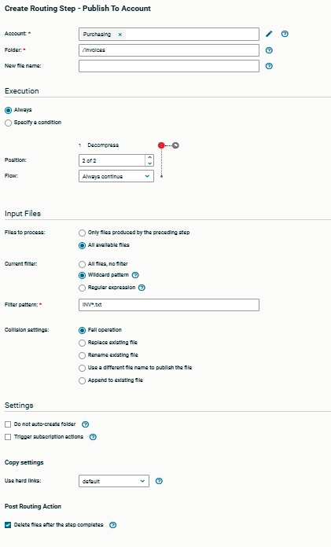

6. Add a *Publish to Account* step to send Invoices to the `Sales` account, in the */Orders* folder and with a wildcard filder for "ORD*.txt", processing all available files and not only the ones coming from the previous step. Make sure you delete the file at the end of the step so the next steps do no see the file. Set the collision settings to "Use a different filename..."

   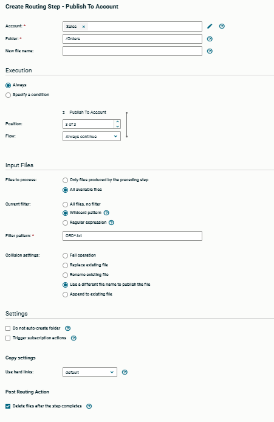

7. Add a final *Publish to Account* step sending all other files to the `UNKNOWN` account. After the previous 2 steps had picked up the files they need, the only files still in the folder need to be handled by this step. Use the folder "/", mark the step to process all available files and check the "Trigger Subscription Actions" checkbox so when the file lands in the `UNKNOWN` account, ST sends the mails we setup earlier. Set the collision settings to "Use a different filename..."

   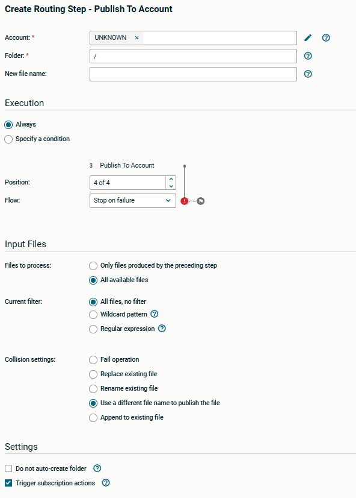

Don't forget to save your template when you are done and then close the template.

---

### Task 8: Create the Partner1 account

This is the account that your parner will use to send you the files for processing. 

1. Create the account with the usual values in the mandatory fields and with a password of `axway`. 

   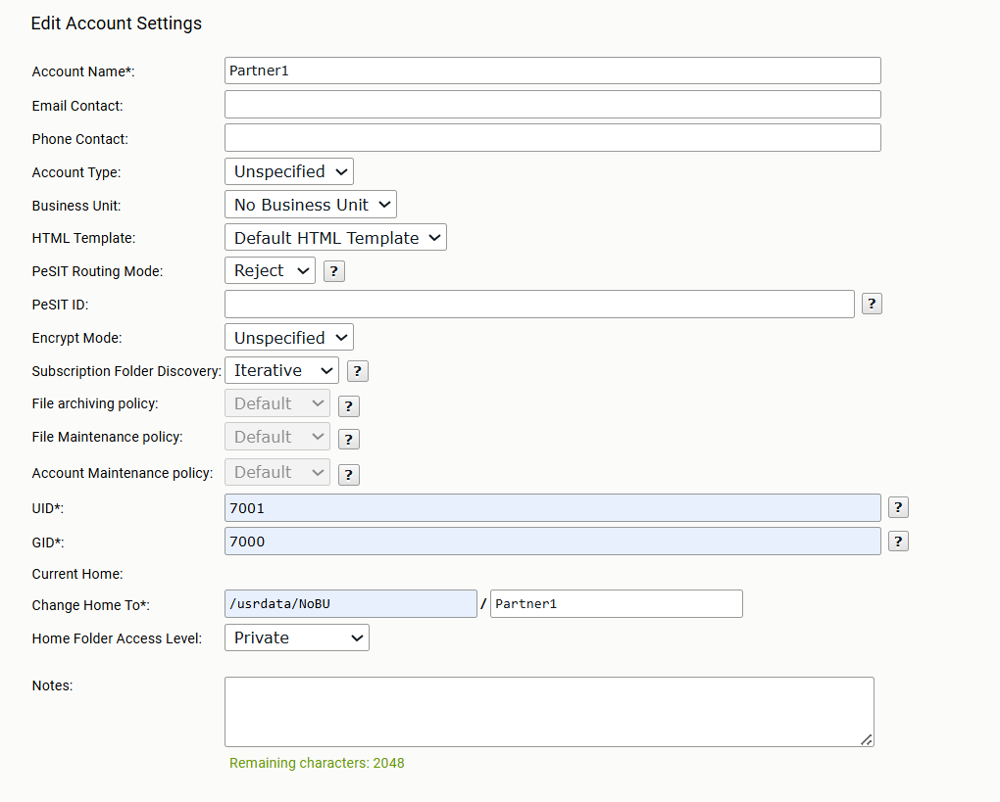

---

### Task 9: Create the composite route package for Partner1

1. Use the *Partner1 Decompress* route template and create the new package route with the name `PR_decompress`

---

### Task 10: Add the Subscription to Partner1

This is the folder where the files will be received to be processed. 

1. Add a subscription to the Advanced Routing application *AdvRouting*

2. Change the subscription folder to `/fromPartner1`

3. Select the `PR_decompress` Route

4. Make sure you *Delete* the files after a successful routing.

---

### Task 11: SMTP settings

If you reinstalled SecureTransport as part of your class, the mail server is not configured. Check the *SMTP group* in the *Server Configuration* menu and make sure the parameters are filled in as shown. Ask your instructor for help if necessary.

   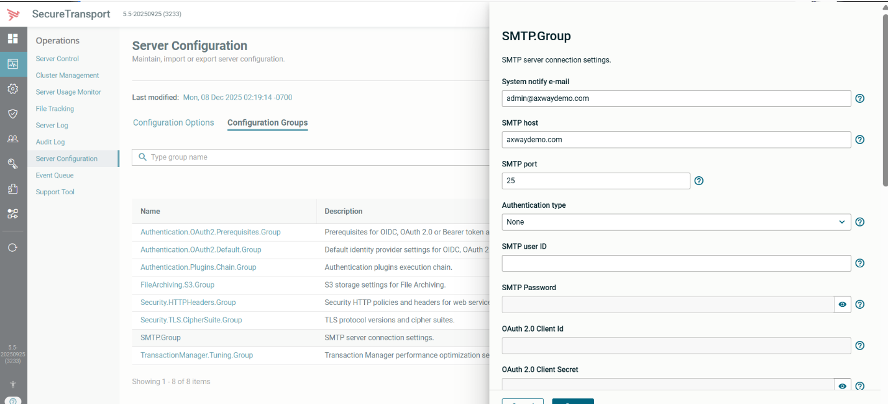

---

### Task 12: Receive and Process the Files

1. Initiate the flow by submitting files yourself or ask your instructor to send you a zip file. Files are located in `STSOURCE/EX10`. Create a zip that contains the types of files that you need and upload it in the folder. If you want to, you can even use ST to do that (Hint: we did an exercise that creates a zip file from multiple files)

   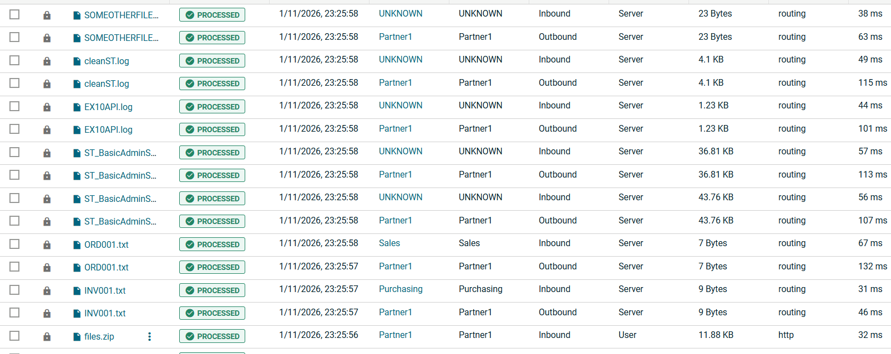

2. Check your email at `https://mft-env:10033`

3. Login to the demo web mail server as `student01` / password `student01` 

4. You will see this email:

   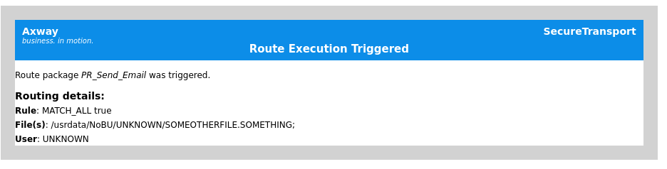

> If you do not see the email, inspect your ST server logs, resolve any errors, then execute your flow again.

### Task 13: (Bonus) User Error Handling

The exercise expects that the user will always send an archive. Try to upload a file that is not a zip file and see what happens. Can you change the route template to handle this case and to send the file to the *UNKNOWN* account? Make sure that if the partner sends a file matching one of our expected patterns, the file still ends up in the *UNKNOWN* account.

---

