# Axway University
# SecureTransport File Flows


| ST Update | May 2026 |
| ---- | ---- |
| Exercise Update | October 2026 |


---

## Exercise 11 – PGP

### About This Exercise

In this exercise, we will practice using PGP Encryption and Decryption within Advanced Routing flows. Your partner (your instructor) have been asked by their seciruty team to implement PGP encryption for the Order and Invoice system you are using with them. You need to transmit the Orders encrypted and you will receive the Invoices back encrypted as well. Your internal application that produces and consumes these files has no PGP capabilities so you need to encrypt the files for the partner before sending them and decrypt the received files before delivering back to your internal application. 

### High Level Solution

Before we can exchange PGP encrypted files with the partner, we will need to exchange public keys. As we both have working MFT servers, we had agreed on a process that will allow the files to be sent securely. We will use two accounts on our server:

1. 'EX11PGP' which the partner will use to login into our server and first send us their public key and then to send us the encrypted invoices. 
2. 'PGPInternal' which will be used by the internal team who creates the orders and need to receive the invoices. 

We will build the solution in 2 stages

#### Stage 1 - Exchange keys

1. Create the two accounts
2. Provide a secure space for the partner to upload their public key
3. Generate a private key and send it to the partner. As you do not like doing things manually, we will create a route which can send a key to the partner any time we need to send a new one. 
4. Import the key we received from the partner

#### Stage 2 - Exchange files

Now that we have keys, we can exchange files. To do that, we will build two routes:
1. An Encryption route which receives an unencrypted Order file, encrypts it and sends it to the partner. 
2. A Decryption route which receives an encrypted Invoice from the partner, decrypts and delivers it to the 'PGPInternal' account. 

The routes will be built in the accounts which see the files first: the decryption one is going to be in the partner account ('EX11PGP') while the encryption one will be in the internal account. 

>You can design this exercise in different ways. The important part is to keep the separation of credentials - you do not have the credentials for the EX11PGP account and your partner does not have credentials for the PGPInternal account. 

---

### Task 1: Build an account for the partner

| Field | Value |
| --- | --- |
| Account Name | EX11PGP |
| UID | 7001 |
| GID | 7000 |
| Home Directory | `/usrdata/NoBU/EX11PGP` |
| Password | axway |

---

### Task 2: Create a folder for the partner's public key

SecureTransport will create any subscription directory that does not exist when a user logs in so we will use that feature to provide a folder for the partner.

1. On the `EX11PGP` account, create subscription using the Basic Application we created earlier and using `/partnersPGPKeyIn` as a subscription folder. Don't forget to press "Add".

2. The subscription will not process the file – you are creating it so that ST can create the folder for the partner to send you their key

---

### Task 3: Ask your instructor to transmit his/her PGP public key to you

Use the File Tracking table to discover where it is on the file system. As in this lab the browser we are using is on the same OS as the ST server, we can use that location to import the key from in the next exercise.

As this is a training class, you can also login as the `EX11PGP` account and download the file to a different location. In the real world you will not have access to that account's credentials. Instead you will need to set the subscription for this folder in a way that puts the key where you can have access. The bonus Task 15 at the end of this exercise will give you a chance to design this process if you wish to do so.

---

### Task 4: Import your Partner's Public PGP key

1. Select the `EX11PGP` account, go to *Certificates* and select *Partner Certificates*

   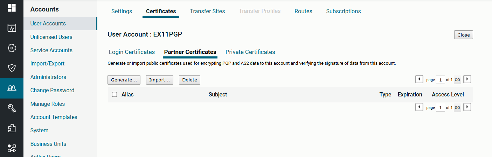

2. Select *Import…*

3. Click *PGP key*

4. Provide an alias – i.e. `Instructor Public PGP Key`

   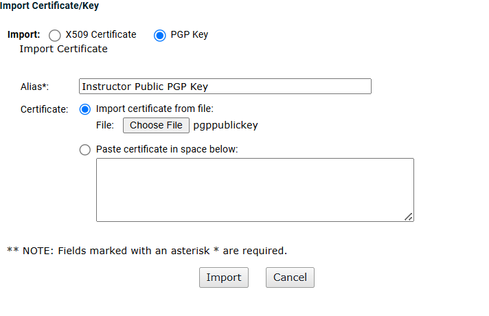

5. Navigate to the  file and press *Import*. If successful, you should see the imported key.

   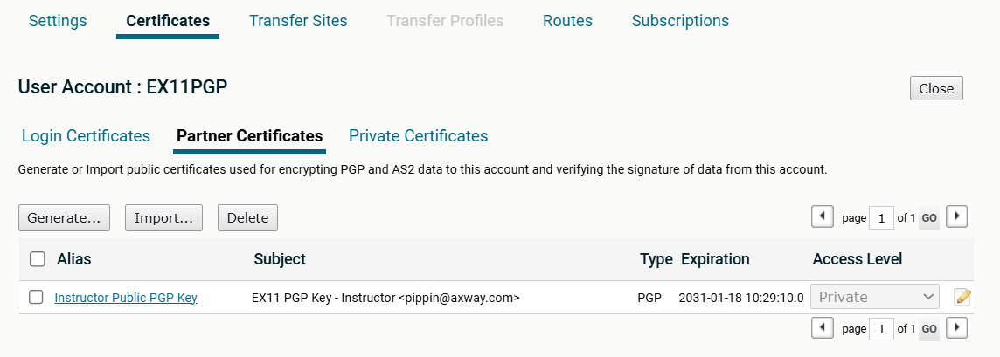

6. Change the Access level of the key to public and press the "save" icon next to the setting. 

   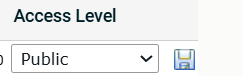

---

### Task 5: Edit the TS_SFTP_Instructor site in the Instructor account

Earlier in the class we created the *TS_SFTP_Instructor* site in the *Instructor* account. We will edit this site so we can use it again. If you prefe to keep the old site so you can run the previous exercises, consult exercise 6 for the details on creating a new site. 

1. Edit the Transfer site *TS_SFTP_Instructor* site in the *Instructor* account and check the *Allow Upload Folder Overwrite* box

2. Change the upload folder to the following expression:

   ```text
   ${stenv.subscription_attr_uservars_uploadfolder}
   ```

   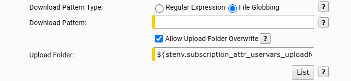

3. Change the username to `ex11`; the password is again `axway`

   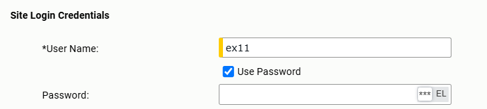

> The expression in the upload folder will allow us to use a subscription parameter to specify the folder where we want to upload a file. This will allow us to use the same site both for the keys exchange and for the actual data later. The checkbox *Allow Upload Folder Overwrite* allows the folder to be overwritten from a Send To Partner step giving us even more flexibility.

---

### Task 6: Create your own Private PGP key

1. Go to the 'Certificates' tab in the `EX11PGP` account, navigat eto the *Private Certificates* tab and press 'Generate'

   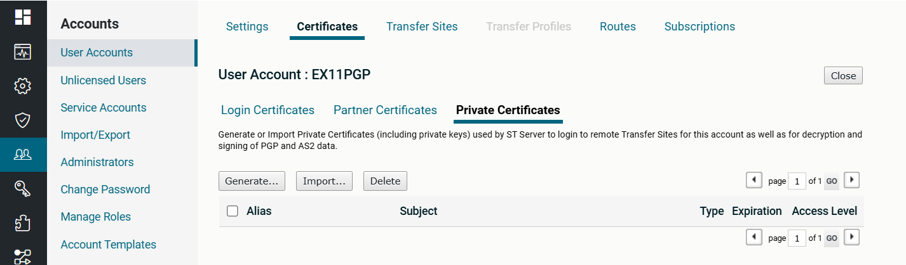

2. Create an RSA PGP certificate of 4096 bytes. Substitute your server name  where we have `Stockbroker`{: .green}. Use 0 for the expiration. If your screen looks different, make sure you had switched to PGP at the top of the screen.

   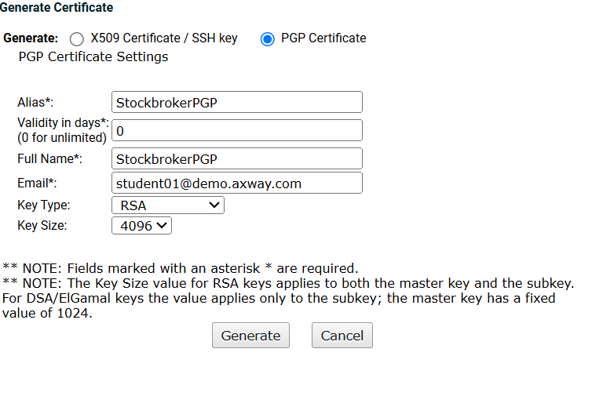

3. Export your PGP public key by clicking the Alias in the list of certificates

   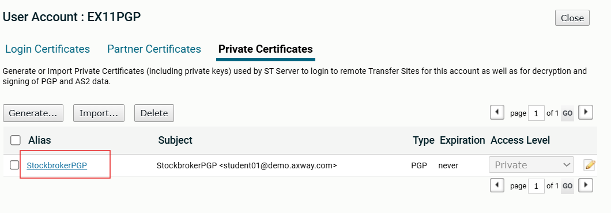

4. Select *Export*. Do NOT select *Export private key* on the next screen (you do not want to share your private key with other people)

   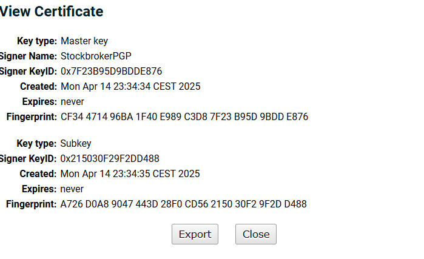

Your key will be downloaded as `xxxxxxxx.asc`.

---

### Task 7: Create an 'Empty' Route Template if you do not have one

You should already have one from exercise 10. If you skipped the exercise or modified the route, create a new Route Template with the name 'Empty' and no routes. 

---

### Task 8: Create an account PGPInternal

This account will be used by the internal team to exchange files with the partner via the `EX11PGP` account. Make sure that the Home folder access is set to Public so that the `EX11PGP` account can deliver the decrypted files it receives back to you. All the other fields can be populated similarly to how we created all the accounts in this lab.

---


### Task 9: Create a Package Route to Transmit your PGP key

In the previous exercises, we created all the simple routes in the route templates. But they can also be created inside of the composite route packages. This is done usually when there is only one user that needs this specific login. We will use this approach in this exercise so you can get used to using this UI as well. As we usually will not have access to the `EX11PGP` account credentials, we will use the `PGPInternal` account.

1. Select the Empty Route Template to create a new Route in the `PGPInternal` account

   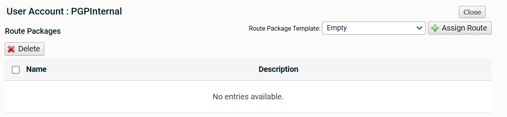

2. Call your package Route `PR_sendKey`

3. Add a Simple route `SR_SendKey` by clicking on the "+Add Route" in the Specific Settings section of the route package.

4. Add a Send To Partner step by clicking on "Select Step" dropdown, locating the step (in this UI it is towards the bottom unlike the template route one) and pressing "+Add Step".

5. Uncheck "Proceed with route execution on step failure".

6. Select "Specify An Account Name" and in the newly opened field type "Instructor".

7. Click on the Transfer site *TS_SFTP_Instructor*

8. Overwrite the upload folder to be `/KeyFromStockbroker` (replace `Stockbroker`{: .green} with your server name)

   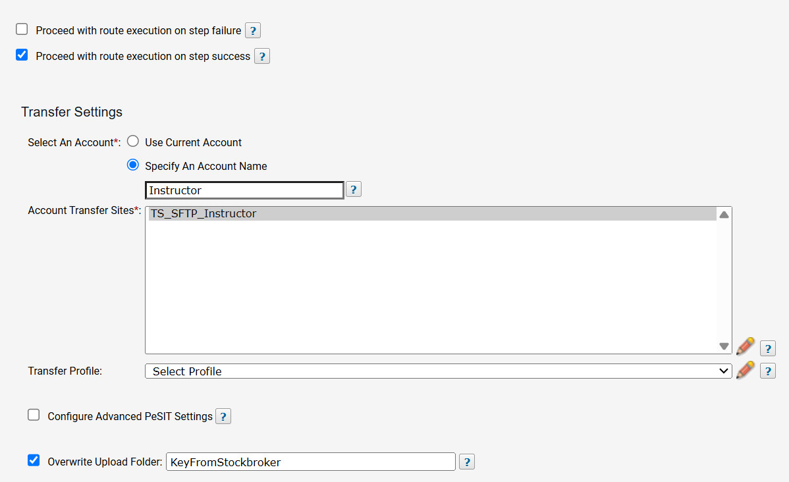

9. Press *Save* to save the step, then *Save* again to save the route and then *Save* again to save the package. 

10. Create an Advanced Routing subscription with folder `/KeyToInstructor` and select the Route we just created. You may also want to delete the key after a successful routing.

   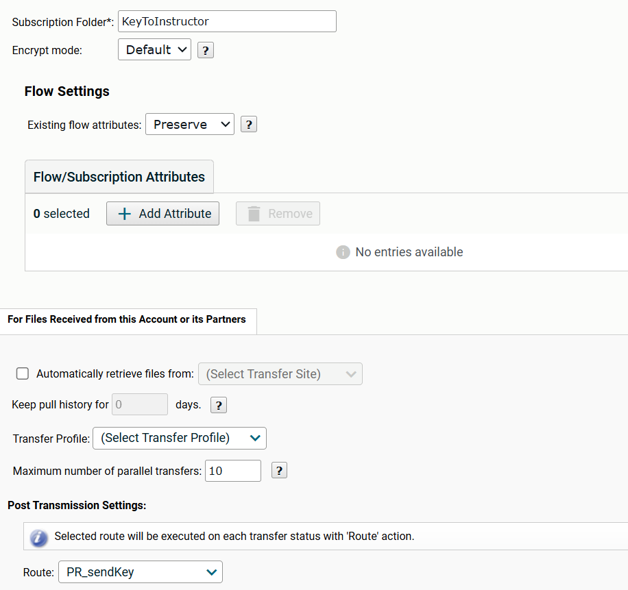

---

### Task 10: Send your PGP public key to your instructor

1. Use the web client to upload your Public PGP key to the `/KeyToInstructor` folder using the `PGPInternal` account.

2. Let your instructor know that you sent them your PGP public key

   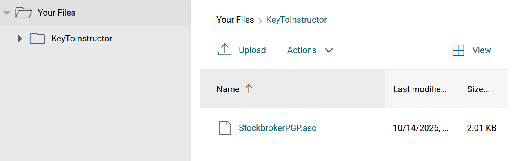

---

### Task 11: Create the PGPInternal account Package route for Encryption

As the internal application has access only to the `PGPInternal` account, we will built the encryption route there while using the key from `EX11PGP` and the site from the `Insructor` account.

1. Create a new route package in the `PGPInternal` using the Empty template. 

2. Call your package route `PR_ENCRYPT`

3. Create a new local simple route called `SR_ENCRYPT`

4. Add a "PGP Encryption" step

   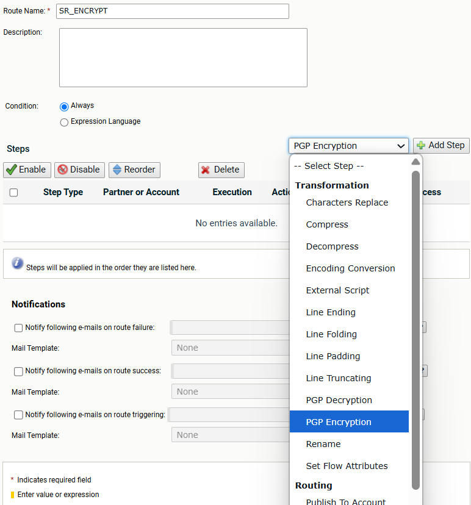

5. For this exercise, use *Encrypt Only*. Type in the account name (EX11PGP) and the key name (Instructor Public PGP Key). After the second letter the server should find them for you.

   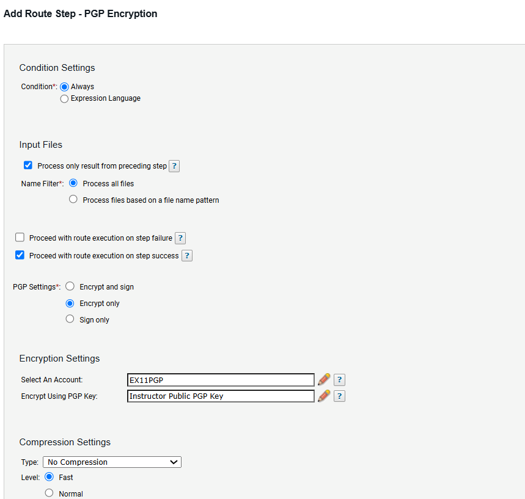

6. Add a *Send to Partner* Step

7. Select the Instructor account and the `TS_SFTP_Instructor` Transfer site and uncheck "Proceed with route execution on step failure"

8. Check the *Overwrite Upload Folder* box and enter:

   ```text
   EncryptedFromStockbroker
   ```

   (Replace `Stockbroker`{: .green} with your server name, first letter capitalized)

   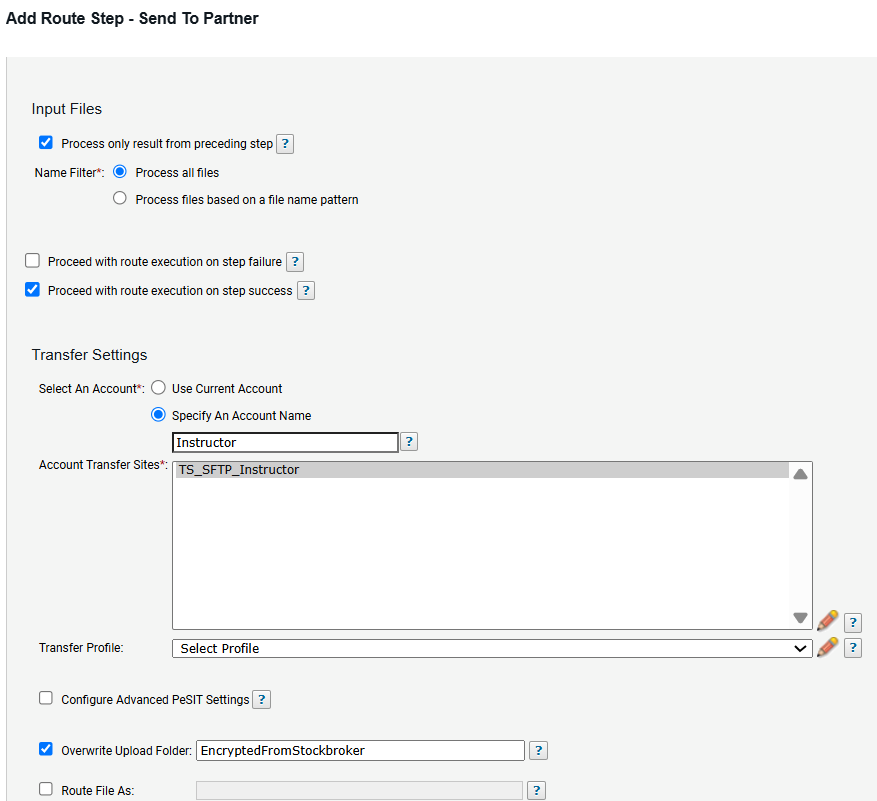

9. Save the step, Save the route and Save the template. 

10. Create the subscription (using the Advanced Routing application) with a folder name like `/EncryptandSendToInstructor`

11. Select your Package route

    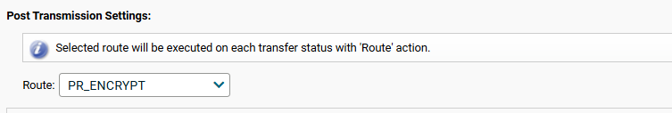

12. Set the On Success Post Routing Action to *move* to:

    ```text
    /archive/${stenv.target}
    ```

    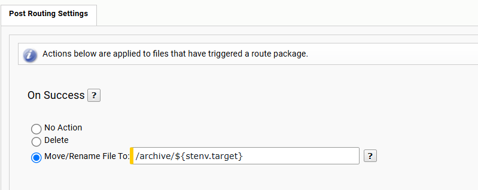
This will move the unencrypted file into the archive folder so we can use it for testing. Once the testing is completed, you can change this configuration to the more common deletion on success. 

> Don't send any files yet – we'll build the rest of the scenario first.

---

### Task 12: Build a Decryption Package Route in the EX11PGP account


1. Using the Empty template, create a package route in the `EX11PGP` account

2. Call it `PR_Decrypt`

3. Add an `SR_decrypt` simple route

4. Add a PGP Decryption step (encryption only, no signature). Leave all the other fields to their default values.

   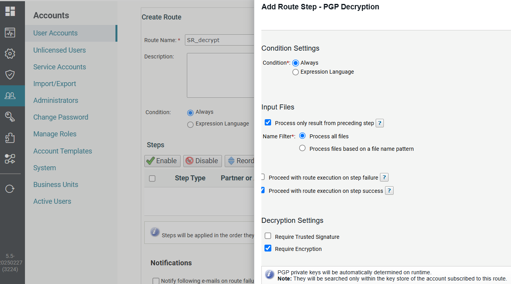

5. Press Save to save the step. 

6. Add a *Publish to Account* step to send the file to the 'Decrypted' folder in the `PGPInternal` account. Decide on a collision setting. 

    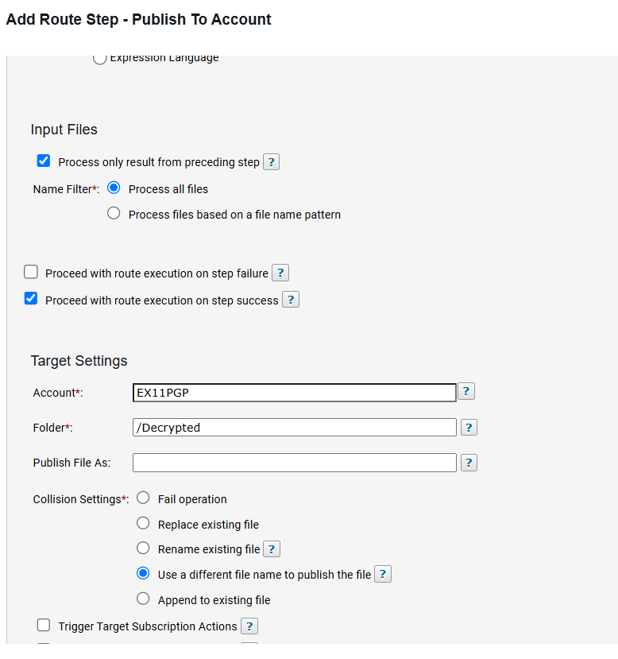

Save the step, the route and the template. 

---

### Task 13: Create the Subscription in the EX11PGP account 

1. Create an advanced routing subscription with folder `/EncryptedFromInstructor`

2. Link to your Package Route `PR_Decrypt` and delete on Route success.

   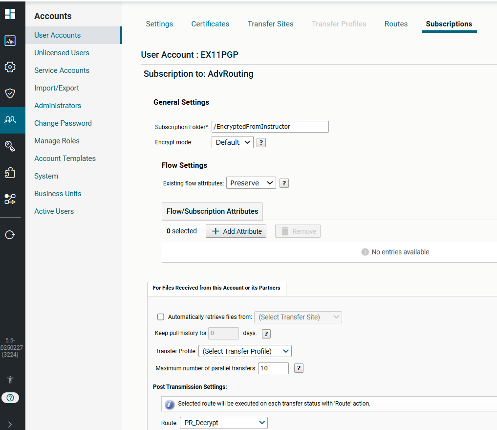

---

### Task 14: Now send a file

Login to the user interface with your `PGPInternal` account and upload a file in the `/EncryptandSendToInstructor` folder.

This test will not be the usual process in which you send an order and receive back an invoice. Instead the partner will decrypt the order file you sent, re-encrypt it with your public key and send it back to you so you can validate that the file you received back is the same as the file you transmitted.

Remember that you archived the outgoing file in `/EncryptandSendtoInstructor/archive` and received the decrypted version in `/Decrypted`. If everything was created properly, you should have identical files in both folders.

Once this is verified, the communication is proven and now you can exchange actual orders and invoices. Do not forget to clear up any archive copies you may not want to keep for actual files.

---

### Task 15: (Bonus) Receive partner's key, part 2

In Task 3, we grabbed the file from the File system directly. In the real world you do not always have access. How would you change the setup for the receiving of the keys so that the received key either ends up in the PGPInternal account (which you can download from) or in another location where you have access to?

---
